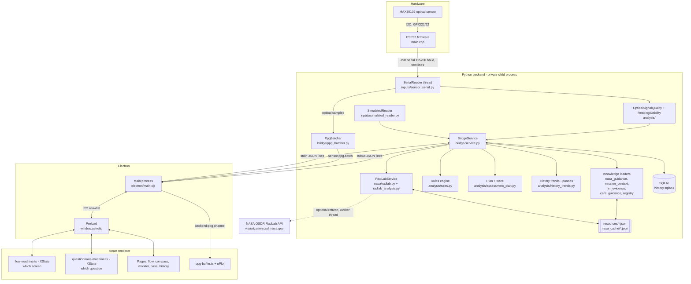
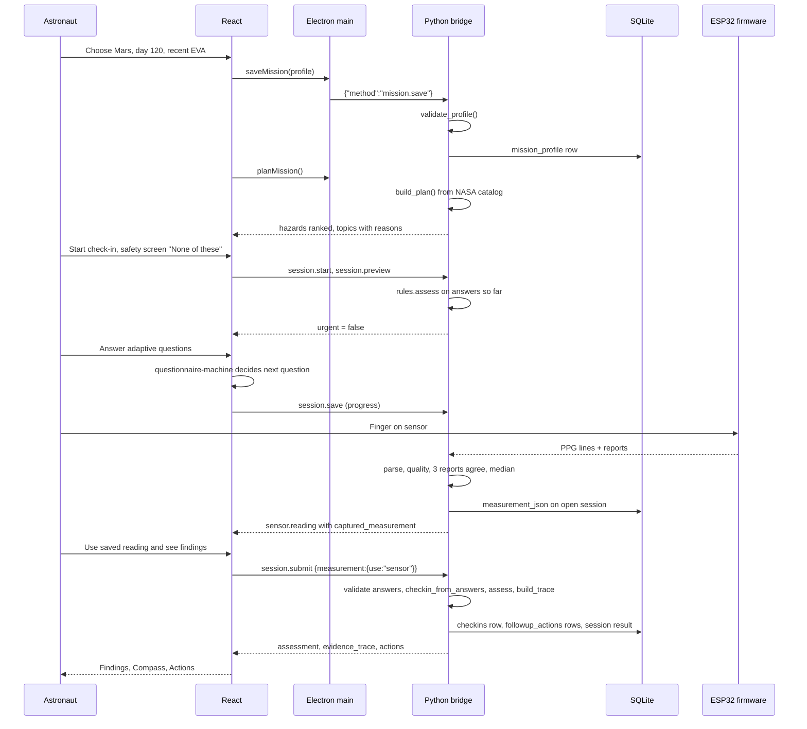
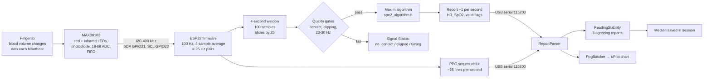
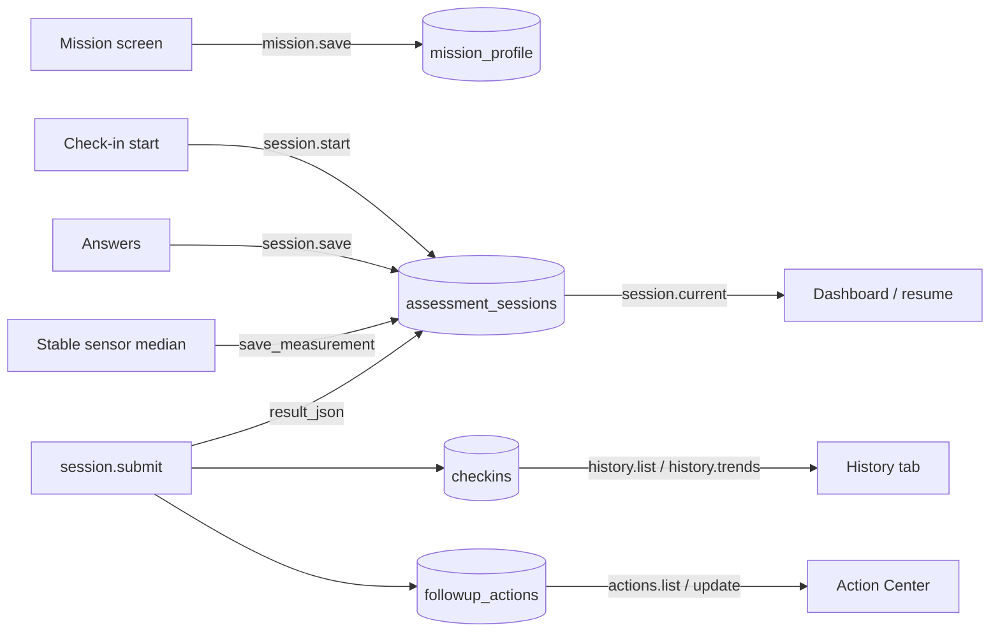

# B. Software architecture handbook

How AstroLife works as one system, from the photons in the sensor to the
prompt on the screen. Every claim points to a file you can open.

Contents

1. [The big picture](#1-the-big-picture)
2. [How the application runs, start to finish](#2-how-the-application-runs-start-to-finish)
3. [Module by module](#3-module-by-module)
4. [Hardware, firmware and sensor data](#4-hardware-firmware-and-sensor-data)
5. [Health analysis and decision-making](#5-health-analysis-and-decision-making)
6. [UI/UX and interactive visualization](#6-uiux-and-interactive-visualization)
7. [Data storage](#7-data-storage)
8. [Three levels of architecture explanation](#8-three-levels-of-architecture-explanation)

---

## 1. The big picture

### 1.1 The one rule

**The interface never scores anything.** React decides *which screen and which
question* comes next. Python decides *what the answers and measurements mean*.
This rule is why the medical logic can be tested in one place, versioned, and
trusted: there is no second copy of it in the UI.

### 1.2 Layers that actually exist

| Layer | Where | Responsibility |
|---|---|---|
| Hardware and sensor | MAX30102 on an ESP32 | Measure red and infrared light through a fingertip |
| Firmware | `electrical/firmware/max30102_serial_test/src/main.cpp` | Sample at 25 Hz, run the heart-rate/SpO₂ algorithm, apply quality gates, print text over USB |
| Data acquisition | `software/astrotip/inputs/sensor_serial.py` | Read the serial port on a background thread, parse reports and samples |
| Validation and quality | `analysis/optical_quality.py`, `analysis/reading_stability.py`, `questionnaire/registry.py`, `nasa/models.py` | Reject bad sensor windows, require agreement, validate answers and NASA data |
| Application logic | `bridge/service.py` | Route requests, own sessions, capture measurements, call the rules |
| Knowledge base | `software/resources/*.json` + loaders in `analysis/` | Curated NASA hazards, risks, evidence, questions, indicators, guidance |
| Analysis | `analysis/rules.py`, `assessment_plan.py`, `history_trends.py`, `nasa/radlab_analysis.py` | Rules, plan, trace, descriptive statistics |
| External API | `nasa/radlab.py` (in app), `nasa/osdr.py` (developer refresh) | Retrieve NASA datasets |
| Storage | `storage/database.py`, `storage/app_state.py` | One SQLite file |
| Desktop shell | `desktop/electron/` | Start the backend, relay messages, enforce security |
| Presentation | `desktop/src/` | Guided screens, charts, 3D views |
| Build and deployment | `desktop/scripts/`, `.github/workflows/desktop-installers.yml` | PyInstaller backend, electron-builder installers, CI |

Layers that do **not** exist: a web server, a cloud service, a search index,
an ML model, a vector database.

### 1.3 Architecture diagram



### 1.4 Reading the diagram, step by step

1. **Sensor to firmware.** The MAX30102 sits on the ESP32's I²C bus. The
   firmware reads paired red/infrared samples from the sensor's FIFO.
2. **Firmware to Python.** The firmware prints two kinds of text lines over USB
   serial: `PPG,...` samples about 25 times per second, and a full report about
   once per second.
3. **Acquisition.** `SerialReader` is a Qt background thread (`QThread`). It
   reads bytes, feeds them to `ReportParser`, and emits Qt *signals* for each
   parsed report, sample or status message.
4. **Quality.** `OpticalSignalQuality` checks the raw sample stream;
   `ReadingStability` checks that three reports agree.
5. **Bridge.** `BridgeService` is the hub. It receives requests from Electron,
   calls the right handler, and pushes events (sensor readings, PPG batches)
   back out.
6. **Knowledge.** At startup the bridge loads and validates every JSON file in
   `software/resources/`. If a file is broken, the backend fails at startup
   instead of showing wrong information later.
7. **Analysis.** The rules engine, the plan/trace builder, the history
   summariser and the RadLab analysis are pure functions over data.
8. **Storage.** One SQLite file holds history, mission, sessions and actions.
9. **Electron.** The main process starts Python, writes requests to its stdin,
   reads its stdout, and relays results to the renderer through IPC.
10. **React.** Two XState machines decide navigation and question flow. Pages
    render what the backend returns. Raw PPG samples bypass React state and go
    straight into a ring buffer that uPlot draws.

### How I would explain this during the presentation

"There are three programs working together. The ESP32 firmware measures and
estimates pulse and oxygen. A Python backend does everything that has to be
correct: it validates the sensor data, runs our rules, handles NASA data and
saves to a local database. The React interface inside Electron only guides
the astronaut and displays results. They talk through plain JSON messages
over a private pipe, so there is no server and nothing on the network."

---

## 2. How the application runs, start to finish

### 2.1 Launch

| Step | What happens | Responsible code |
|---|---|---|
| 1 | User opens AstroLife (installed app, `npm start` or `npm run demo`) | `desktop/electron/main.cjs` |
| 2 | Electron creates a sandboxed window (`contextIsolation: true`, `nodeIntegration: false`, `sandbox: true`) and loads the built React app from `dist/index.html` | `createWindow` in `main.cjs` |
| 3 | Electron spawns the Python backend as a child process: from source `python -m astrotip.bridge.service` with the repo's `.venv`; when packaged, the bundled `astrotip-backend` executable | `PythonBridge.start`, `electron/backend-runtime.cjs` |
| 4 | Python creates a `QCoreApplication` (Qt event loop, no window), constructs `BridgeService`, which loads and validates the catalog, mission context, question registry, HRR evidence, indicators, OSDR studies and care guidance | `bridge/service.py` `BridgeService.__init__` |
| 5 | A plain Python thread starts reading stdin; Python prints `{"event":"backend.ready"}` | `main()` in `service.py` |
| 6 | Electron waits up to 60 s for `backend.ready`; then IPC calls are allowed | `PythonBridge.start` |
| 7 | React calls `ping`, then in parallel `getConfig`, `getKnowledge`, `currentSession` | `App.tsx` `start()` |
| 8 | React sends `LOADED` to the flow machine; every launch opens on the intro (welcome) page | `flow/flow-machine.ts` |

### 2.2 A full check-in



### 2.3 Stage by stage

| Stage | What moves | Component |
|---|---|---|
| Input: mission | `{environment, phase, mission_day, eva_recent, gravity_transition_recent}` | `mission-page.tsx`, `context-page.tsx` → `mission_context.validate_profile` |
| Input: answers | `{question_id: value}` | `questions-page.tsx` + `questionnaire-machine.ts`; validated by `registry.validate_answer` |
| Input: measurement | Firmware report → `SensorReading` | `sensor_serial.ReportParser` |
| Processing | Answers → `CheckIn` dataclass | `questionnaire/session.checkin_from_answers` |
| Analysis | `CheckIn` → `Assessment` (findings, notes, indicator status) | `rules.assess` |
| Explanation | Findings → evidence trace | `assessment_plan.build_trace` |
| Storage | Check-in, assessment, actions, session | `HistoryStore.save`, `AppStateStore.complete_session` |
| Display | JSON result → screens | `findings-page.tsx`, `compass-page.tsx`, `actions-page.tsx` |

### 2.4 Asynchronous work and background tasks

| Work | Runs on | Why |
|---|---|---|
| Serial reading | `SerialReader` (`QThread`) | A blocking serial read must not freeze request handling |
| stdin reading | Plain `threading.Thread` → Qt signal | Requests are handed to the Qt thread through a signal, so handlers run one at a time |
| PPG batching | `QTimer` every 80 ms | Groups ~25 samples/s into small batches to reduce message overhead |
| RadLab refresh | Daemon `threading.Thread`; result as `nasa.radlab.updated` event | A slow network never delays sensor events |
| Every renderer call | `ipcRenderer.invoke` (a Promise) | The UI awaits results; default timeout 8 s per request in `main.cjs` |
| Chart drawing | `requestAnimationFrame` loop in `ppg-chart.tsx` | Draws at screen refresh rate from the ring buffer, outside React rendering |

### 2.5 Error handling

| Failure | What the code does |
|---|---|
| Unknown bridge method or malformed JSON | Rejected with an error response (`handle_request`) |
| Input line over 1 MB | Treated as invalid (`MAX_LINE_BYTES`) |
| Unexpected Python exception | Logged to stderr; renderer gets a generic "backend could not complete the request" message |
| Request takes too long | Electron rejects the Promise after the timeout |
| Backend exits | Electron sends `backend.stopped` to the renderer |
| Serial port busy or unplugged | `SerialReader` emits a readable status: "Close other serial monitors and check the cable / COM port" |
| Finger removed | Live estimate withdrawn immediately; a saved session capture is kept |
| Broken resource file | Backend refuses to start (validation in every loader) |
| NASA unreachable | Verified cache shown with the reason; if no cache, "unavailable" |
| Damaged cache | Checksum mismatch → refused |
| Newer database version | `AppStateStore` refuses to open it |

### How I would explain this during the presentation

"When you open AstroLife, Electron starts our Python backend as a hidden child
process. Python loads and validates all our NASA knowledge files before it
says it is ready, so a broken file fails at startup instead of giving wrong
advice later. From then on, every button in the UI sends a small JSON request
to Python, and Python answers. The sensor runs on its own thread and pushes
readings as events."

---

## 3. Module by module

### 3.1 Python backend (`software/astrotip/`)

| Component | Technology | Purpose | Input | Processing | Output | Connects to |
|---|---|---|---|---|---|---|
| `bridge/service.py` `BridgeService` | Python, PySide6 `QCoreApplication`, signals/slots | Request router and session owner | JSON requests on stdin | Dispatch to 24 handlers; capture measurements | JSON responses and events on stdout | Everything below; Electron |
| `bridge/ppg_batcher.py` `PpgBatcher` | Python | Batch raw optical samples for the chart | `OpticalSample` objects | Drop exact repeats; cap queue at 256; flush every 80 ms or 32 samples | `sensor.ppg.batch` events | `SerialReader`, Electron |
| `inputs/sensor_serial.py` `SerialReader`, `ReportParser` | pyserial, `QThread` | Read and parse firmware output | Bytes from USB | Frame lines; parse reports and `PPG` lines; reject partial, malformed, `-1`, invalid | `SensorReading`, `OpticalSample`, status text | Firmware, bridge |
| `inputs/simulated_reader.py` | Python | Demo stream without hardware | — | Writes firmware-format text through the real parser (72 bpm, 98 %) | Same events, `source: "simulated"` | Bridge |
| `analysis/optical_quality.py` `OpticalSignalQuality` | Python `statistics` | Engineering checks on raw samples | Last 100 samples | Contact, clipping, sequence continuity, 20–30 Hz rate, baseline drift | `ready`, `no_contact`, `clipped`, `timing`, … | Bridge |
| `analysis/reading_stability.py` `ReadingStability` | Python `statistics.median` | Require agreement before saving | Last 3 reports | Heart rate within max(6 bpm, 8 %), SpO₂ within 2 points, span ≥ 1.8 s | `steady` + median, or `collecting`/`changing` | Bridge |
| `questionnaire/registry.py` | Python | Validate registry and answers; decide eligibility | `question_registry.json`, answers, mission | `show_if` evaluation, domain order, drop answers that no longer apply | Visible questions, cleaned answers | Bridge, plan |
| `questionnaire/session.py` | Python | Turn answers into a `CheckIn` | Answers + measurement | Map `maps_to` to symptom keys and fields | `CheckIn`, session notes | Rules |
| `analysis/rules.py` `assess` | Python | The assessment | `CheckIn` | Fixed rules (section 5) | `Assessment` with findings, notes, indicator status | Bridge, trace |
| `analysis/assessment_plan.py` | Python, Pydantic | NASA-informed plan and trace | Catalog, mission, registry, indicators, HRR | Rank hazards, order topics, link findings to risks and observations | Plan dict; trace list | Bridge |
| `analysis/care_guidance.py` | Python | Load sourced self-care steps | `care_guidance.json` | Validate each step has text and a catalog source | Steps per trigger | Rules |
| `analysis/nasa_guidance.py` | Python | Load and validate NASA catalog | `nasa_sources.json` | HTTPS sources, 5 hazards, 13 topics, every entry sourced | Catalog dict | Everything |
| `analysis/mission_context.py` | Python | Mission hazard order and profile validation | `mission_context.json`, profile | Check all hazards present per mission; validate profile | Context, clean profile | Plan, bridge |
| `analysis/hrr_evidence.py` | Python | Roadmap evidence per topic | `hrr_evidence.json` | Links must be on `humanresearchroadmap.nasa.gov` and match risk id | Evidence dict | Plan, trace, UI |
| `analysis/history_trends.py` | pandas | Descriptive history summary | Saved check-ins | Exclude simulated; count, mean, min, max, latest vs previous | Trend dict | Bridge |
| `nasa/radlab.py` `RadLabService` | `urllib`, pandas, Pydantic, `hashlib` | NASA radiation pipeline | CSV from RadLab API or cache | Retrieve → validate → clean → store | Verified dataset | Bridge, analysis |
| `nasa/radlab_analysis.py` | pandas, NumPy | Per-instrument statistics | Dataset | Mean, median, p95, gaps, excursions, hourly | Analysis + plain statements | `RadLabService` |
| `nasa/osdr.py` | `urllib`, Pydantic | One OSDR study record | JSON from API (dev refresh) or cache | Validate, checksum | Study card data | Bridge (`knowledge.get`) |
| `nasa/models.py` | Pydantic | Typed models | Raw dicts | Validation of readings, datasets, indicators, provenance | Models | NASA modules, plan |
| `models/health_indicator.py` | Python dataclasses | `CheckIn`, `Assessment`, `Finding`, `SYMPTOMS` | — | — | Shared data shapes | Everyone |
| `storage/database.py` `HistoryStore` | `sqlite3` | Saved check-ins | `CheckIn`, `Assessment` | INSERT / SELECT JSON columns | Rows | Bridge |
| `storage/app_state.py` `AppStateStore` | `sqlite3` | Mission, sessions, actions | Dicts | Schema migrations with `PRAGMA user_version` | Rows | Bridge |
| `ui/` | PySide6 widgets, pyqtgraph | Earlier Qt interface, kept as fallback | — | — | Qt window via `software/run.py` | Same Python modules |

**Empty placeholder files** (0 bytes, not implemented):
`analysis/local_ai.py`, `inputs/camera_capture.py`, `inputs/image_input.py`,
`inputs/manual_input.py`, `ui/pages/photos.py`.

### 3.2 Electron shell (`desktop/electron/`)

| File | Purpose |
|---|---|
| `main.cjs` | Creates the window; `PythonBridge` class spawns Python, assigns request ids, matches responses, applies timeouts, forwards events (PPG on its own `backend:ppg` channel); maps 23 IPC channels one-to-one to bridge methods; checks the sender's URL; blocks navigation and new windows; opens external links only for `https://*.nasa.gov`; stops the backend on quit |
| `preload.cjs` | Exposes `window.astrotip` with one function per operation through `contextBridge`. This is the only door from the web page to the system |
| `backend-runtime.cjs` | Picks the command to start Python: bundled executable when packaged; `.venv` Python or `ASTROTIP_PYTHON` in development |

### 3.3 React renderer (`desktop/src/`)

| Folder / file | Purpose |
|---|---|
| `App.tsx` | Top-level state: loads knowledge and session, owns sensor state, connects the flow machine to pages |
| `flow/flow-machine.ts` | XState machine for navigation: `welcome → mission → context → hazards → safety → questions → measure → findings → compass → actions → dashboard`, plus `urgent` reachable from everywhere with history to return |
| `questions/engine.ts` | TypeScript copy of question eligibility (`conditionMet`, `domainOrder`, `visibleQuestions`, `applicableAnswers`) |
| `questions/questionnaire-machine.ts` | XState machine holding answers and position; `ANSWER` re-evaluates which questions exist and reports `dropped` follow-ups |
| `components/flow/*` | One file per guided screen |
| `components/compass/*` | 3D anatomy viewer and the region mapping |
| `components/monitor/*` | Live PPG chart and sensor dock |
| `components/nasa/*` | Radiation Explorer, series chart, OSDR study card |
| `components/pages/*` | Dashboard tabs: Monitor, Compass, NASA data, History, quick assessment |
| `components/effects/*` | Star background, NASA astronaut scene, cursor-reactive hover |
| `lib/ppg-buffer.ts`, `lib/ppg-store.ts` | Typed-array ring buffer for PPG samples, outside React state |
| `lib/api.ts` | Typed wrapper around `window.astrotip` |
| `types/*` | TypeScript shapes of every backend response |

### 3.4 Why the separation matters

- **Separation of concerns.** Medical logic in one language and one place
  (`rules.py`), so one test suite covers it.
- **Trust boundary.** The renderer cannot invent a sensor reading:
  `session.submit` with `use: "sensor"` reads the backend's captured value.
- **Replaceable UI.** The PySide6 fallback (`software/run.py`) uses the same
  Python modules, which shows the backend is independent of the React UI.
- **Event-driven design.** The sensor pushes events; the UI reacts. Nothing
  polls.
- **Signals and slots.** Qt's way of connecting an event (a *signal*, such as
  `reading_received`) to a function that handles it (a *slot*). It also hands
  data safely from a background thread to the main thread.

### How I would explain this during the presentation

"We split the backend by responsibility: inputs read the sensor, analysis
holds the rules and statistics, nasa holds the API pipelines, storage owns
SQLite, and the bridge connects them. The React side has two state machines:
one for which screen you are on, one for which question comes next. The
medical logic exists only in Python, so the UI cannot drift from it."

---

## 4. Hardware, firmware and sensor data

### 4.1 End-to-end flow



### 4.2 Each component

| Component | What it is | What it does in AstroLife | What it sends next |
|---|---|---|---|
| MAX30102 | Optical pulse-oximetry sensor module: red and infrared LEDs, a photodiode, an analog-to-digital converter and a sample FIFO | Configured by `sensor.setup(60, 4, 2, 100, 411, 4096)`: LED brightness 60, 4-sample averaging, red + IR mode, 100 samples/s, 411 µs pulse width, 4096 ADC range | Red and IR counts (0–262,143) over I²C |
| I²C | Two-wire bus (data SDA, clock SCL) for chips on a board | ESP32 GPIO21 = SDA, GPIO22 = SCL, fast mode | Register reads |
| ESP32 | Microcontroller with USB serial | Runs the firmware loop | Text over USB |
| Firmware `astro-life-ppg-2` | C++ on the Arduino framework | Reads paired FIFO samples (`readSample`), prints every pair as `PPG,...`, keeps a 100-sample window, slides it by 25, gates quality, calls `maxim_heart_rate_and_oxygen_saturation`, prints a report | Two line formats (below) |
| USB serial | Virtual COM port at 115200 baud | One program at a time can hold it | Bytes |
| `SerialReader` | Python thread using pyserial | Opens the port with DTR/RTS low to avoid resetting the ESP32; reads what is waiting | Parsed events |

Line formats (from `docs/HARDWARE.md` and `main.cpp`):

```text
PPG,1234,56789,123456,145678          ← sequence, device ms, red, infrared
======================================
       ASTRO LIFE HEALTH MONITOR
Signal Status: ready
Sample Rate: 25.0 Hz
Finger Detection: Likely detected
Heart Rate: 72 BPM
Measurement Valid: Yes
Blood Oxygen (SpO2): 98%
Measurement Valid: Yes
...
```

### 4.3 Raw PPG vs estimate vs validated measurement

| Term | What it is in AstroLife | Can it be trusted medically? |
|---|---|---|
| **Raw PPG** | The red/infrared counts in `PPG` lines. The chart draws infrared, inverted and baseline-filtered for display only | No. It is a light signal, not a vital sign |
| **Estimate** | Heart rate and SpO₂ from the Maxim algorithm on the ESP32, with its valid flags | Experimental. Not compared with a reference device |
| **Stable reading** | Median of three agreeing estimates, saved in the session | An engineering consistency check, still not validated |
| **Clinically validated measurement** | A reading from certified equipment compared against a reference | AstroLife does not produce one. Values typed from another instrument are stored as `manual` |

### 4.4 Quality checks, layer by layer

| Where | Check | Effect |
|---|---|---|
| Firmware | Every sample in the window has IR > 50,000 (finger contact) | Otherwise `no_contact`, no estimate |
| Firmware | No zero red, no sample at the 18-bit ceiling | Otherwise `clipped` |
| Firmware | Measured rate 20–30 Hz (algorithm assumes 25) | Otherwise `timing` |
| Firmware | FIFO backlog ≥ library buffer | Restarts collection with `ERROR:` line |
| Firmware | Display gates: HR 35–220, SpO₂ 70–100, algorithm valid flag | Otherwise "Unavailable" |
| Parser | Complete report only; never mixes fields from two reports; `-1` and "Unavailable" become no value; rate outside 20–30 Hz downgrades status to `timing` | Partial/invalid reports dropped |
| Parser | `PPG` line must be five fields of digits within range | Malformed sample message |
| `PpgBatcher` | Drops an exact repeat of the previous sample (seen at port open on the real board) | Chart not polluted |
| `OpticalSignalQuality` | Contact, clipping, consecutive sequence numbers, increasing time, rate, drift | Not `ready` → stability reset |
| `ReadingStability` | 3 reports within tolerance over ≥ 1.8 s, gaps ≤ 8 s | Only then a median is offered |
| Bridge | Contact lost between reports → withdraw the live estimate at once | No stale value shown |

### 4.5 Synchronization and connection loss

- Device timestamps and sequence numbers are forwarded unchanged, so the chart
  breaks the line at a real gap instead of joining across it.
- If the PPG queue backs up, the oldest samples are dropped and counted in
  `dropped`.
- On disconnect, `_sensor_finished` stops the timer, clears quality state and
  emits `sensor.connection: disconnected`.
- A saved session capture survives contact loss, disconnect and an app
  restart. "Measure again" (`session.remeasure`) discards it on purpose.

### 4.6 Simulated readings

`SimulatedReader` writes firmware-format text through the real `ReportParser`,
so it exercises the same code path. Every value it produces carries
`source: "simulated"`, is labelled "simulated · not a measurement", is stored
with `input_source = "simulated"`, and is excluded from trends.

### 4.7 Verification status (from `docs/HARDWARE.md`)

| Check | Result |
|---|---|
| 1,500 consecutive samples at 25.05 Hz, no missing sequence numbers (2026-11-14, Jayden Nguyen, Qt monitor) | Passed |
| Real board at 25.0–25.2 Hz, `no_contact` with no finger, estimates correctly unavailable, consecutive sequence numbers in the React app (2026-11-15) | Passed |
| Heart rate and SpO₂ in the React app with a finger on the sensor | **Not yet run** |
| Accuracy against a reference pulse oximeter | **Not done** |

### How I would explain this during the presentation

"The MAX30102 shines red and infrared light into the fingertip and measures
how much comes back; that changes with each heartbeat. The ESP32 reads those
samples over I²C, collects a four-second window, and runs Maxim's algorithm to
estimate heart rate and oxygen saturation. Before it reports anything, it
checks finger contact, clipping and timing. It sends text over USB. Our Python
code parses it, and only saves a reading once three reports in a row agree.
We verified the data transport on the real board, but we have not compared
accuracy with a medical oximeter, so we call these estimates."

---

## 5. Health analysis and decision-making

### 5.1 What methods are actually used

| Method | Used? | Where |
|---|---|---|
| Rule-based logic | **Yes**, the core | `analysis/rules.py` |
| Threshold evaluation | **Yes** | SpO₂ 88/92 %, HR 60–100 bpm, sleep < 6 h |
| Statistical analysis | **Yes**, descriptive only | `history_trends.py` (pandas), `radlab_analysis.py` (pandas, NumPy) |
| Trend analysis | Descriptive (latest vs previous, range, mean) | `history_trends.py`; no interpretation |
| Risk scoring | **No**. Levels are prompt priorities, not risk scores | `LEVEL_ORDER` |
| Machine learning | **No** | `local_ai.py` is empty |
| LLM reasoning | **No** | — |
| Information retrieval | Deterministic lookup by id, not search | Document E |
| NASA-based recommendations | Self-care steps and countermeasures cite NASA pages; selection is by rule trigger | `care_guidance.json`, `nasa_sources.json` |
| Signal consistency heuristics | **Yes** | `reading_stability.py`, `optical_quality.py` |

### 5.2 The rules engine (`rules.assess`, version `2026.11.2`)

**What it is.** A Python function that takes one `CheckIn` (symptoms reported,
heart rate, SpO₂, signal quality, sleep hours, exercise completed, source) and
returns an `Assessment`. It is a fixed set of if-then rules.

**What problem it solves.** It turns scattered observations into a short,
ordered list of prompts with clear escalation, in a way anyone can audit.

**How it works conceptually.**

1. Start every one of the 13 health topics at level `info` (nothing to report).
2. For each reported symptom, look it up in `OBSERVATION_RULES`, which maps it
   to a topic and a level. Example: `chest_pain → (cardiovascular, urgent)`,
   `dizziness → (vestibular, watch)`, `fever_or_infection → (immune, review)`.
3. Apply measurement rules:

   | Input | Condition | Level | Source |
   |---|---|---|---|
   | SpO₂ | ≤ 88 % | urgent ("Act now") | MedlinePlus Pulse Oximetry |
   | SpO₂ | ≤ 92 % | review ("Medical review") | MedlinePlus Pulse Oximetry |
   | SpO₂ with poor signal | any | watch ("measure again") | FDA |
   | Heart rate | outside 60–100 bpm | watch ("recheck") | MedlinePlus Pulse |
   | Sleep | < 6 hours | watch | App reminder, not a clinical cutoff |
   | Exercise | missed | watch on fitness and bone | App reminder |

4. A topic takes the most severe level raised for it.
5. Attach self-care steps from `care_guidance.json` for non-urgent prompts.
   Urgent prompts show only the emergency action.
6. Add notes that state limits (for example "Fingertip readings cannot assess
   radiation dose, bone density, SANS…").
7. Sort findings urgent → review → watch → info; the overall level is the
   most severe.
8. Compute `indicator_status` for colour coding.

**Example.** Input: sleep 5 h, exercise missed, HR 72, SpO₂ 97, no symptoms.
Output: overall level `watch`; findings `sleep` (watch, "Reported sleep was 5
hours…"), `fitness` and `bone` (watch, "exercise session was reported as
missed…"), with self-care steps; heart rate status `in_reference`, SpO₂
`in_reference`; notes saying the readings cannot establish health.

**Limitations.** General adult references, not mission limits; no personal
baseline; only two measured indicators; the rules were written by the team,
not reviewed by a flight surgeon.

**Reliability.** The rules behave exactly as written; `test_rules.py` checks
them. Whether they are *medically appropriate* has not been validated.

### 5.3 How a finding becomes user-facing guidance

| Part of a prompt | Comes from |
|---|---|
| Level label (Act now / Medical review / Follow up) | `Finding.level` |
| "Why" text | `Finding.reason` (rule text) |
| "What you can do now" | `Finding.self_care` (`care_guidance.json`, each with a source) |
| "When to involve the crew" | `Finding.actions` |
| Sources | `Finding.source_ids` resolved against the catalog |
| Six-step trace | `build_trace`: mission, hazard rank, HRR risk, observations, rule, actions |
| Follow-up checklist | `followup_actions` rows created at submit |

### 5.4 Uncertainty, missing data and false alarms

- **Missing data** is never "normal". No SpO₂ → "oxygenation cannot be
  assessed"; no heart rate → "cardiovascular status remains unassessed".
  A check-in without a reading needs a stated reason and is stored as
  unassessed.
- **"Not sure" and "Skip"** are stored and never counted as "no".
- **False alarms** are possible: an active person can have a heart rate
  above 100 at the time of measurement. The rule says "recheck, not a
  diagnosis", and "well-trained people can rest at 40 to 60".
- **Poor signal** produces "measure again", not "low oxygen".
- **The mission never changes a finding.** `assess` has no mission parameter.

### How I would explain this during the presentation

"There is no AI deciding anything medical. The assessment is a fixed set of
Python rules with a version number. A reported symptom maps to a health topic
and a level. SpO₂ and heart rate are compared with general MedlinePlus
references, not NASA limits, because NASA doesn't publish universal vital-sign
cutoffs. Each prompt carries simple steps and when to involve the crew, and a
missing measurement is always 'not assessed', never 'fine'. We chose rules so
every prompt can be traced and tested."

---

## 6. UI/UX and interactive visualization

### 6.1 Framework and navigation

- **Electron** provides the desktop window; **React 19** renders the screens;
  **Vite** builds them; **Tailwind CSS v4** styles them.
- **Navigation** is the `flowMachine` (XState). Each state is a screen. Events
  are `NEXT`, `BACK`, `EXIT`, `RESUME`, `START_CHECKIN`, `REPORT_URGENT`, and so
  on. Guards decide, for example, that `BACK` from Mission goes to the
  dashboard for a returning astronaut but to Welcome for a new one.
- **Report concern** sends `REPORT_URGENT` from any screen; `CLOSE_URGENT`
  returns to the last screen through XState's history state.
- After onboarding, a **dashboard** with tabs (Dashboard, Monitor, Compass,
  NASA data, History) is the home base (`components/app-shell.tsx`).

### 6.2 State management

| State | Lives in | Why |
|---|---|---|
| Current screen | `flowMachine` | Deterministic, testable navigation |
| Answers and question position | `questionnaireMachine` (and saved to Python with `session.save`) | Instant reaction in the UI; durable in the backend |
| Mission, sessions, results, actions | Python / SQLite, loaded with `currentSession` | Survives restarts |
| Live sensor values | `App.tsx` React state, updated from `sensor.reading` events | Re-render small widgets |
| Raw PPG samples | `ppgBuffer` typed arrays (`lib/ppg-buffer.ts`) | 25 samples/s would cause too many React renders |

### 6.3 Interactive elements and their logic

| User action | Event handler | Software logic | UI update |
|---|---|---|---|
| Choose a mission card | `mission-selector.tsx` radio group | `saveMission` → `validate_profile` → SQLite; `planMission` → `build_plan` | Hazards page with ordered hazards and plan |
| Answer a question (click or number key) | `questions-page.tsx` → `ANSWER` event | `applyAnswer` re-runs `questionnaireView`; follow-ups added/removed | Next card; note if answers were dropped |
| Tick a safety item | `safety-page.tsx` → `SET_ANSWERS`; `previewSession` | `rules.assess` on answers so far | Urgent panel if level is urgent |
| Rest finger on sensor | — (events) | Parser → stability → capture | Live values, progress 1/3, 2/3, "Saved measurement" |
| "Measure again" | `remeasureSession` | Clears saved capture and stability window | Back to collecting |
| Submit | `submitSession` | Full assessment + trace + actions | Findings page |
| Hover a body structure or pin | `onPointerOver` in `anatomy-viewer.tsx` | `regionForStructure` maps mesh → region | Hover card with recorded value, first prompt, NASA risk titles |
| Click a body region | `onClick` / region button | Select region; camera flies to it (drei `Bounds`) | Region panel: measurements, prompts with steps, NASA research, OSDR study, actions |
| Tick an action | `updateAction` | `set_action_status` in SQLite | Checked; dashboard count updates |
| "Retrieve again from NASA" | `getRadLab(true)` | Worker thread → RadLab API → validate → cache | `nasa.radlab.updated` event refreshes the explorer |

### 6.4 3D rendering

- **Health Compass**: `@react-three/fiber` (React renderer for three.js) draws
  the `open-anatomy-3d` male or female anatomy GLB models. Systems can be
  toggled (skeleton, organs, muscles, …). The skin surface and reproductive
  structures are removed before rendering (`isExcluded`). Pins label regions;
  hover shows a short summary; clicking flies the camera to the region.
  `Bvh` speeds up picking. The frame loop runs on demand unless spinning.
- **Welcome scene**: the NASA 3D Resources astronaut model
  (`public/models/nasa-astronaut.glb`) is decoration only, reacting to the
  cursor. It is unmounted while the Compass runs so only one WebGL scene
  exists at a time.
- **Without WebGL**, the Compass says so and stays usable through its region
  buttons.

### 6.5 Charts

| Chart | Library | Data |
|---|---|---|
| Live optical pulse | uPlot, redrawn via `requestAnimationFrame` from the ring buffer | Raw infrared (red optional), display-only filter |
| RadLab day series | uPlot (`components/nasa/series-chart.tsx`) | Selected instrument's values |
| History trends | Table | `history_trends.summarize_history` |

### 6.6 Feedback and error states

Telemetry freshness ("Updated…", "Stalled"), loading skeletons, inline field
errors, "No reading" instead of a stale number, visible serial errors, labelled
simulated mode in the header, backend-stopped message, pause-motion control
and OS reduced-motion support, keyboard shortcuts with an in-app reference.

### 6.7 Why the UI supports self-assessment (not just decoration)

- One question at a time reduces load; "why this question" explains purpose.
- Colour coding always has a text label (accessible, not colour-only).
- The body view answers "where does this prompt belong?" spatially.
- Provenance and "not a measurement of you" badges prevent misreading data.

### 6.8 Third-party design sources

Space Portfolio, Space UI, Magic UI, shadcn/ui and Radix UI (MIT) components
were adapted; licenses are in `desktop/THIRD_PARTY_NOTICES.md` and the design
reviews in `docs/UI_UX.md`.

### How I would explain this during the presentation

"Navigation is a state machine, so every screen transition is defined and
tested; you can report a concern from anywhere and come back to the same
step. The question flow is a second state machine that adds or removes
follow-ups as you answer. The Health Compass is a real 3D anatomy model in
React Three Fiber: hovering shows a short summary and clicking a region shows
your recorded value, the prompts and the NASA research for that part of the
body."

---

## 7. Data storage

### 7.1 Where and what

One SQLite file: `~/.local/share/AstroTip/history.sqlite3` on macOS/Linux,
`%LOCALAPPDATA%\AstroTip\history.sqlite3` on Windows (the folder kept its old
name for compatibility). `ASTROTIP_HISTORY_PATH` overrides it; `npm run demo`
uses a temporary file.

| Table | Owner | One row is | Key columns |
|---|---|---|---|
| `checkins` | `HistoryStore` | A saved check-in | `created_at`, `checkin_json`, `assessment_json` |
| `mission_profile` | `AppStateStore` | The single mission (`id = 1`) | `profile_json` |
| `assessment_sessions` | `AppStateStore` | A check-in in progress, submitted or abandoned | `status`, `answers_json`, `position`, `measurement_json`, `result_json`, `registry_version` |
| `followup_actions` | `AppStateStore` | One follow-up step | `condition_id`, `level`, `text`, `status` (`open`/`done`) |

Schema version: `PRAGMA user_version = 2`. Migrations run in order on open.

A RadLab dataset retrieved live is cached next to the database in
`nasa_cache/`. The bundled caches stay read-only in `software/resources/nasa_cache/`.

### 7.2 Concepts

- A **table** is like a spreadsheet; a **record** (row) is one entry.
- A **query** is a SQL statement such as
  `SELECT ... FROM checkins ORDER BY id DESC`.
- **Persistence**: data is written to disk, so it survives restarts.
- AstroLife stores nested data as **JSON text** in a column, which keeps the
  schema simple while preserving the full assessment snapshot (including the
  rules version and catalog review date).

### 7.3 Data flow



### 7.4 Sensitive data

- Nothing is written until there is something to save.
- Raw 25 Hz PPG samples are never stored; only the bounded aggregate with
  source, port, time, method and report count.
- The file is **not encrypted**. Anyone with access to the computer account can
  read it.
- No health data is sent to any external service.

### How I would explain this during the presentation

"Everything is in one local SQLite file. There are four tables: saved
check-ins, the mission profile, check-in sessions so you can resume after a
restart, and follow-up actions. Each saved assessment keeps the rules version
and the date the NASA catalog was reviewed, so we know exactly what produced
it. It is not encrypted yet, and the app tells you that."

---

## 8. Three levels of architecture explanation

### Level 1: non-technical

```text
Finger on sensor ──► Computer program ──► Simple screens
(measures pulse      (asks questions,      (what to do next,
 and oxygen)          checks answers,       and why)
                      uses NASA research)
```

**Say:** "A small sensor measures your pulse and oxygen. The program asks you
questions that NASA's research says matter most for your kind of mission,
then tells you what to keep an eye on and when to talk to the crew doctor. It
shows where each piece of advice came from. Nothing leaves the computer."

### Level 2: undergraduate engineering (preferred)

```text
ESP32 + MAX30102 ─USB serial─► Python backend ─JSON lines─► Electron ─IPC─► React UI
 C++ firmware:                  pyserial thread             main process     XState flow
 25 Hz PPG, HR/SpO2             rules engine                + preload        + question machine
 quality gates                  NASA pipelines (pandas)     allowlist        uPlot charts
                                SQLite storage                               React Three Fiber
```

**Say:** "Firmware estimates the vitals. A Python backend, started by Electron
as a private child process, parses and validates them, runs a versioned rules
engine, handles NASA data with pandas and Pydantic, and stores everything in
SQLite. Electron relays JSON messages through an IPC allowlist to a React
interface driven by two XState machines. The UI never scores anything."

### Level 3: technical judge questions

| Topic | Detail to have ready |
|---|---|
| Protocol | Protocol version 2; request `{id, method, params}`; response `{id, ok, result|error}`; events `{event, payload}`; 1 MB line limit; 24 methods; 6 event types |
| Concurrency | Qt event loop on the main thread; serial on `QThread`; stdin on a thread → Qt signal; RadLab refresh on a daemon thread |
| Performance | PPG batched every 80 ms or 32 samples, queue cap 256; chart draws from typed arrays via `requestAnimationFrame`; one WebGL scene at a time; lazy 3D chunks |
| Security | `contextIsolation`, `sandbox`, no Node in renderer, sender-URL check, navigation and window-open blocked, external links only `https://*.nasa.gov`, no network listener |
| Data integrity | Pydantic models; SHA-256 of response and canonical data; atomic cache writes (`tempfile` + `os.replace`); bounded requests (15 s timeout, 8 MB, 50,000 rows) |
| Determinism | Same mission + answers → same questions (shared test vectors run in Python and TypeScript); same check-in → same findings regardless of mission |
| Traceability | `rules_version`, `catalog_reviewed_on`, `question_registry_version`, `evidence_reviewed_on`, rule ids, observation ids, action ids stored with each result |
| Measurement trust | Renderer cannot supply sensor values; backend uses its captured median |
| Limits | No clinical validation; RadLab unit unknown; macOS-only manual runs; unencrypted storage |

**Say:** "The backend speaks a small JSON-lines protocol over stdin and
stdout, so there's no port to attack. Qt's event loop serialises request
handling while the serial port and NASA download run on their own threads.
Every NASA response is validated with Pydantic and stored with SHA-256
checksums, and every result carries the versions of the rules and knowledge
that produced it."
