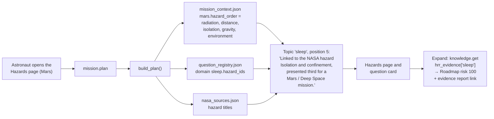
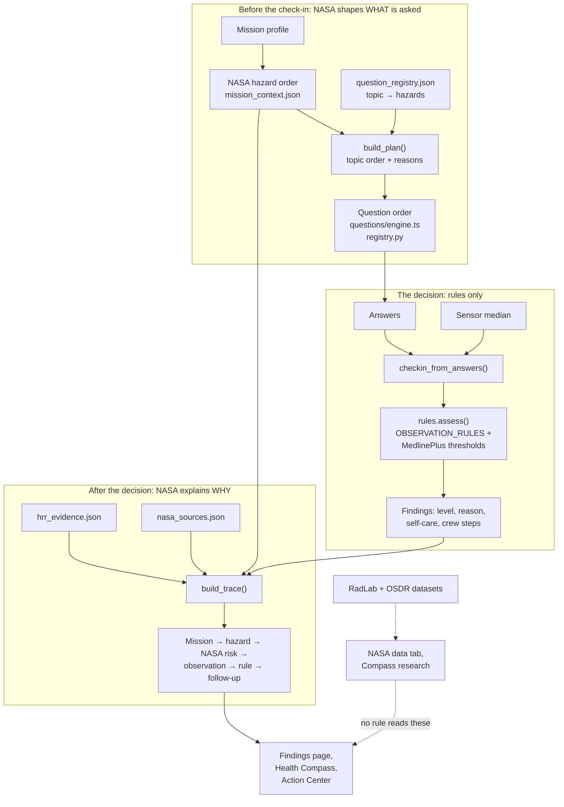

# E. NASA knowledge, "search", and decision-making

This document answers the three questions judges are most likely to push on:

1. What kind of search or retrieval does AstroLife use?
2. Where exactly does NASA information meet the health decisions?
3. How do you stop the app from making unsupported medical claims?

The full inventory of every data source and API, with pipelines and code
walkthroughs, is in
[data-sources-and-api-architecture.md](data-sources-and-api-architecture.md).
This document focuses on retrieval and decisions.

All example outputs below were produced by running the real backend functions
(`build_plan`, `checkin_from_answers`, `assess`, `build_trace`) on 2026-11-15.
They are not made up.

---

## 1. What kind of search system is it?

**AstroLife has no search engine.** The audit checked for every type the
preparation prompt listed:

| Type | Present? | Evidence |
|---|---|---|
| Keyword search box | No | No search input in `desktop/src`; no query handler in `bridge/service.py` |
| Full-text search / SQLite FTS | No | The SQLite schema (`storage/app_state.py`) has four plain tables, no FTS virtual table |
| Semantic / vector / embedding search | No | No embedding library or vector store in any requirements or `package.json` |
| Retrieval-augmented generation (RAG) | No | No language model anywhere |
| API-based remote search in the app | No | The app's only NASA call is a fixed RadLab query |
| Hybrid search | No | — |

What it uses instead is best called **curated, identifier-keyed knowledge
lookup**:

- NASA knowledge was **read by the team** from NASA web pages and encoded into
  JSON files in `software/resources/`.
- Every entry has an **identifier**. Health topics are ids like `sleep`,
  `hypoxia`, `fitness`. Hazards are `radiation`, `isolation`, `distance`,
  `gravity`, `environment`. Sources are ids like `medlineplus_pulse`.
- At startup, each file is **loaded and validated** (structure, HTTPS links,
  every claim has a source).
- When the app needs NASA information, it **looks it up by id**: "give me the
  Roadmap reports for `sleep`" is `hrr["conditions"]["sleep"]`. There is no
  ranking, no relevance score, no fuzzy matching.

The **only real call to a NASA search endpoint** in the repository is in the
developer script `software/scripts/fetch_nasa_media.py`. Its `search()`
function calls `https://images-api.nasa.gov/search?q=...&media_type=image`
to confirm a hand-picked `nasa_id` and read its title, credit and date for the
decorative mission images. It is run by a developer, not by the app, and it
has nothing to do with health.

### Why this approach instead of a search engine

| Reason | Explanation |
|---|---|
| Correctness | A health app must not surface a loosely matching paragraph. Curated entries were checked by a person and link to their exact source |
| Determinism | The same input always gives the same evidence. A search ranking can change with the index |
| Offline | No index server, no model, no network |
| Auditability | Every finding stores the source ids, Roadmap risk ids and review dates it used |
| Scale | The knowledge base is small: 5 hazards, 13 topics, 30 sources, 27 questions, 4 indicators. Lookup by id is the right tool at this size |

### What "the knowledge base" contains

| File | Contents | Validated by |
|---|---|---|
| `nasa_sources.json` | 5 hazards, 13 health topics (why it matters, monitoring, countermeasures with evidence status, research, limitations), 30 sources (23 NASA, 7 MedlinePlus/FDA) | `nasa_guidance.validate_catalog` |
| `mission_context.json` | Hazard order and NASA-sourced rationale for LEO, lunar, Mars; phases | `mission_context.validate_mission_context` |
| `hrr_evidence.json` | Human Research Roadmap risk id, title, risk page and evidence report per topic | `hrr_evidence.validate_hrr_evidence` |
| `question_registry.json` | 27 questions, 8 topics, `show_if`, `maps_to`, `evidence_ids` | `questionnaire.registry` |
| `health_indicators.json` | Heart rate, SpO₂ (sensor), sleep hours, exercise (question) with linked topics | `assessment_plan.load_indicators` (Pydantic) |
| `care_guidance.json` | Self-care steps per rule trigger, each with a source | `care_guidance.validate_care_guidance` |
| `osdr_studies.json` + `nasa_cache/osdr_OSD-104.json` | One NASA space-biology study linked to `fitness` | `nasa/osdr.py` |
| `radlab_instruments.json` + `nasa_cache/radlab_...json` | RadLab instrument notes and a verified dataset | `nasa/radlab.py` |

### End-to-end example of a "retrieval"

**Question:** "Why does AstroLife ask me about sleep on a Mars mission, and
what does NASA say about it?"

1. The UI calls `planMission()`. No text is "searched".
2. `build_plan` reads Mars's `hazard_order` and, for the `sleep` topic,
   takes the earliest of its hazards in that order.
3. It writes a reason from the hazard title and its rank.
4. The NASA explanation and the Roadmap report for `sleep` are fetched from
   the already-loaded knowledge by the id `sleep`.
5. The link opens NASA's page in the system browser (only `*.nasa.gov` allowed).

Citations are preserved because every entry carries `source_ids` that resolve
to a title and an HTTPS URL in the catalog.

### How I would explain this during the presentation

"We didn't build a search engine, on purpose. For health guidance we wanted
every statement to be checked by a person and linked to its exact NASA page.
So we read the NASA Human Research Program hazard and risk pages and the
Human Research Roadmap, and encoded them as validated data with ids. The app
looks things up by id, for example the sleep topic, so the same input always
gives the same evidence and it works offline. The trade-off is that adding
knowledge is a manual, reviewed step."

---

## 2. How NASA data relates to decisions

### 2.1 The real pipeline

### 2.2 Data used to make a decision vs data used to explain it

This distinction is the most important thing in the document.

| Information | Used to **make** a decision? | Used to **explain or support** it? | Code |
|---|---|---|---|
| Astronaut's answers (symptoms, sleep hours, exercise) | **Yes** | Yes (shown as observations) | `rules.assess` |
| Sensor heart rate and SpO₂ | **Yes** | Yes | `rules.assess`, `indicator_status` |
| MedlinePlus / FDA reference values (88 %, 92 %, 60–100 bpm) | **Yes** (thresholds) | Yes (cited) | `rules.py` constants |
| `OBSERVATION_RULES` (symptom → topic, level) | **Yes** | — | `rules.py`; written by the team |
| `care_guidance.json` steps | Selected by rule trigger | Yes | `care_guidance.steps_for` |
| NASA hazard order per mission | **Decides question order**, not findings | Yes ("why this question", plan) | `build_plan`, `domain_order` |
| NASA topic ↔ hazard links | Decides which topic a question/finding belongs to | Yes | `nasa_sources.json`, registry |
| NASA risk pages, Roadmap evidence reports | No | **Yes** (trace, Compass, NASA tab) | `build_trace` |
| NASA countermeasures | No | **Yes** (actions text, catalog) | `nasa_sources.json` |
| RadLab dataset | No | Context only | `radlab.py` |
| OSDR OSD-104 study | No | Context only | `osdr.py` |
| Mission profile | Decides question order and EVA question presence | Yes | Not an input to `assess` |

So, precisely:

- **NASA data does not set any numeric threshold.** The code comment in
  `rules.assess` says it: "NASA's public pages do not define a universal risk
  order or vital-sign cutoffs."
- **NASA knowledge does decide the structure of the check-in**: topic order,
  which topics a mission promotes, whether the EVA question exists, which
  NASA risk a finding is linked to.
- **NASA evidence is attached after the decision**, as the explanation.
- **Search results are not used in decision-making**, because there is no
  search.
- **Recommendations are selected from stored guidance by rules**, not
  generated. Each stored step restates a cited source.

### 2.3 What prevents unsupported medical conclusions

| Safeguard | Where |
|---|---|
| Fixed, versioned rules (`RULES_VERSION = "2026.11.2"`); no generative text | `rules.py` |
| Every step and every catalog entry must name a source, or the app does not start | `validate_catalog`, `validate_care_guidance` |
| Questions can only map to symptom keys the rules already know; "No question adds a clinical cut-off" | `registry.py` validation; `docs/QUESTION_ENGINE.md` |
| Missing data = "not assessed", never normal | `assess` notes |
| "Not sure" / "Skip" never counted as "no" | registry, session |
| Urgent prompts show only the emergency action | `assess` (`self_care=()` when urgent) |
| Summary for "nothing triggered" says "This is not a medical clearance" | `assess` summaries |
| Notes state what a fingertip sensor cannot assess | `assess` notes |
| Historical NASA data and animal studies labelled as not personal | UI badges |
| Mission cannot change a finding | `assess` has no mission parameter; test in `test_nasa_functional.py` |

---

## 3. Three scenarios traced through the code

Mission for all three: Mars / deep space, in transit, day 120, recent EVA yes.
Plan produced by `build_plan` (positions as returned):

| Position | Topic | Reason (verbatim) |
|---|---|---|
| 1 | safety | Universal safety screen: asked first on every mission. |
| 2 | eva | Moved to the front because your mission context reports: eva recent. |
| 3 | wellbeing | Linked to the NASA hazard "Distance from Earth", presented second for a Mars / Deep Space mission. |
| 4 | illness | Linked to the NASA hazard "Distance from Earth", presented second for a Mars / Deep Space mission. |
| 5 | sleep | Linked to the NASA hazard "Isolation and confinement", presented third for a Mars / Deep Space mission. |
| 6 | balance | Linked to the NASA hazard "Gravity fields", presented fourth for a Mars / Deep Space mission. |
| 7 | heart | Linked to the NASA hazard "Gravity fields", presented fourth for a Mars / Deep Space mission. |
| 8 | strength | Linked to the NASA hazard "Gravity fields", presented fourth for a Mars / Deep Space mission. |

For comparison, a low Earth orbit mission without an EVA starts with
`balance`, `heart`, `strength` ("Gravity fields", presented first), and the
EVA topic is absent. **Same registry, same code, different NASA hazard order.**

### Scenario 1: poor sleep and a missed exercise session

**Input.** Safety all "no"; EVA symptoms "no"; sleep quality "Poorly"; sleep
hours 5; duration "several nights"; exercise "Missed". Sensor median HR 72,
SpO₂ 97.

**Path.** `checkin_from_answers` maps `sleep.quality = poorly` →
symptom `poor_sleep`; `sleep.hours = 5` → field `sleep_hours`;
`strength.exercise = missed` → `exercise_completed = False`. `assess` raises:

| Finding | Level | Reason (from the rules) | Rule ids in trace | NASA hazards (rank on Mars) | Roadmap risk |
|---|---|---|---|---|---|
| sleep | watch | "Reported: poor sleep or disrupted schedule… Reported sleep was 5 hours. Below 6 hours triggers an app reminder, not a NASA clinical cutoff." | `observation:poor_sleep`, `field:sleep_hours` | isolation (3), environment (5) | 100 |
| fitness | watch | "The prescribed exercise session was reported as missed; this does not measure fitness or bone loss." | `field:exercise_completed` | gravity (4) | 180 |
| bone | watch | same | `field:exercise_completed` | gravity (4) | 77 |

Indicators: heart rate `in_reference`, SpO₂ `in_reference`. Overall: `watch`
("Some things to follow up…").

**Where NASA data acted:** it put sleep before balance and strength in the
question order, and it supplied the hazards and Roadmap risks in the trace.
**Where it did not act:** the "watch" level came from the rule for
`poor_sleep` and the 6-hour app reminder.

### Scenario 2: dizziness with an unusual reading

**Input.** Safety all "no"; EVA "no"; dizziness "yes". Sensor HR 108,
SpO₂ 91.

| Finding | Level | Reason | Rule id | Hazard (rank) | Roadmap risk |
|---|---|---|---|---|---|
| hypoxia | **review** | "Reported SpO2 91% meets the general reference for contacting a clinician." | `measurement:spo2` | environment (5) | 173 |
| cardiovascular | watch | "Heart rate 108 bpm is above the general adult resting reference of 60 to 100 bpm. Activity raises the pulse…" | `measurement:heart_rate` | gravity (4) | 179 |
| vestibular | watch | "Reported: dizziness, motion sickness or balance problems. This does not establish a diagnosis." | `observation:dizziness` | gravity (4) | 88 |

Indicators: heart rate `outside_reference` (amber), SpO₂ `review` (amber).
Overall: `review`. The hypoxia finding has no self-care steps and says
"Contact the crew medical officer or a clinician promptly". The heart-rate
finding's first self-care step is "Rest for at least 10 minutes, then measure
again…" (MedlinePlus).

**Thresholds came from** MedlinePlus (`SPO2_REVIEW = 92`,
`RESTING_HEART_RATE = (60, 100)`). **NASA contributed** the hazards and
Roadmap risks 173, 179, 88 in the trace.

### Scenario 3: an emergency on the safety screen

**Input.** Safety "Chest pain or tightness" = yes.

**Path.** `safety-page.tsx` → `session.preview` → `assess`:
`chest_pain → (cardiovascular, urgent)`. Overall `urgent`. The urgent panel
appears immediately, before any further question, with: "Contact the crew
medical officer or emergency medical service now and follow the approved
mission emergency procedure. Do not wait for another sensor reading or this
app." No self-care steps. Source: MedlinePlus "Recognizing medical
emergencies". Trace: hazard gravity (rank 4 on Mars), Roadmap risk 179,
`observation:chest_pain` from question `safety.chest_pain`.

**NASA contributed** nothing to the decision itself; this is intentional.
Emergencies are the same on every mission.

### The answer to "How exactly does AstroLife use NASA data instead of simply displaying it?"

"NASA's hazard and risk research does two jobs in the software. First, it
decides the structure of the check-in: for each mission we encoded NASA's
hazards in an order with a NASA rationale, and that order sets which health
topics are asked first and why; a recent EVA promotes the EVA topic. Second,
it is attached to every result: each prompt is traced to the NASA hazard, the
Human Research Roadmap risk and its evidence report. What NASA data does not
do is set medical thresholds: NASA doesn't publish universal vital-sign
cutoffs, so the thresholds come from MedlinePlus and are labelled as general
references. The RadLab and OSDR datasets are real NASA API data, validated and
analysed, but they are context; no rule reads them."

---

## 4. AI, search, retrieval, rules and calculations: keep them apart

| Term | Means | In AstroLife? |
|---|---|---|
| **AI / machine learning** | A model learned from data makes a prediction | **No** |
| **LLM** | A language model generates text | **No** (AI assistants helped write code and docs during development; none runs in the app) |
| **Search** | Find items matching a query, usually ranked | **No** (only a developer script calls NASA's image search) |
| **Retrieval** | Fetch stored information | **Yes**, by identifier |
| **Deterministic rules** | Fixed if-then logic | **Yes**, `rules.assess` |
| **State machine** | Defined states and transitions | **Yes**, XState flow and questionnaire |
| **Ordinary calculations** | Median, mean, percentiles | **Yes**, stability median, pandas/NumPy statistics |
| **Data validation** | Check data against a schema | **Yes**, Pydantic and loaders |

## How I would explain this during the presentation

"People sometimes expect AI here, and it's a fair question. We decided that
anything medical had to be traceable to a rule and a source, so the check-in
is adaptive through a state machine, and the assessment is a fixed rules
engine with a version number. NASA's research decides what's asked first and
explains every result; general MedlinePlus references set the two numeric
thresholds, and the app says that on screen."
