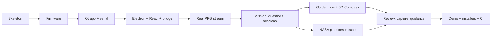

# F. Development phases, testing, packaging and release

How AstroLife went from an idea to an installable desktop app, what the tests
prove, and how installers are built.

**Verified history vs reconstruction.** Commit hashes, dates and authors below
are from `git log` (about 100 commits, 2026-11-13 to 2026-11-15). The phase
grouping follows `docs/CHANGELOG.md`, which the team wrote. "Engineering
problems" are only listed where a commit message or doc records them.

---

## 1. Development phases

### Phase 1: Problem research and project skeleton (2026-11-13)

- **Objective:** Understand the challenge; lay out the repository.
- **Built:** `ecd0ab3` initial commit; `1a9faff` "initialize the project
  structure and rough software architecture" (the `inputs/`, `analysis/`,
  `models/`, `storage/`, `ui/` layout that still exists, including the empty
  `camera_capture.py`, `image_input.py`, `manual_input.py`, `local_ai.py`
  placeholders that were never filled).
- **Tools:** Git, Python package layout.
- **Connects to:** The separation of concerns used for the rest of the project.

### Phase 2: Hardware and firmware (2026-11-14)

- **Objective:** Get heart rate and SpO₂ from the provided ESP32.
- **Built:** `51a81f6` MAX30102 serial firmware; `238f327` "fix misaligned
  sample channels (unreliable data) from the sensor" (red and IR had to come
  from the same FIFO entry, which is why `readSample` uses `getFIFORed()` and
  `getFIFOIR()` together); `22957bd` firmware changes.
- **Tools:** PlatformIO, Arduino framework, SparkFun MAX3010x library.
- **Problem recorded:** Misaligned channels gave unreliable data; fixed by
  reading paired FIFO samples.

### Phase 3: First desktop application and NASA sorting (2026-11-14)

- **Objective:** Read the sensor on a computer; first look at NASA data.
- **Built:** `a97b486` (Jayden Nguyen) "Analyze and sort NASA data, and create
  basic UI": the first NASA catalog (`resources/nasa_sources.json`,
  `analysis/nasa_guidance.py`), the first rules (`analysis/rules.py`), the
  serial reader (`inputs/sensor_serial.py`), the SQLite history store, and the
  PySide6 interface (`ui/main_window.py`, sensor, check-in, assessment and
  history pages).
- **Tools:** PySide6, pyserial, JSON, SQLite.
- **Connects to:** Every later layer grew from these modules: the bridge reuses
  the serial reader, the rules engine and the catalog.

### Phase 4: Electron + React interface (2026-11-14)

- **Objective:** A modern visual tool with motion and 3D.
- **Built:** `28bb3cb` offline NASA media cache; `bce43f6` JSON-lines Python
  bridge; `fa5e460` React + Electron interface; then layout fixes, design
  tokens, NASA mission cards, accessibility (`23c1946` pause motion,
  `55f4a35` WCAG AA contrast), telemetry freshness, keyboard shortcuts
  (`64996da`), tests and docs.
- **Why Electron + Python bridge:** keep the Python backend and sensor code,
  add a web UI, avoid a network server.
- **Recorded:** Impeccable and UI UX Pro Max design reviews (`28d918c`,
  `05cfd85`).

### Phase 5: Branding (2026-11-14)

`40d4620` rename AstroTip → AstroLife (user-visible text); `93b69aa` logo and
icon. Internal names (`astrotip` package, `AstroTip` data folder) were kept
for compatibility.

### Phase 6: Merge and real sensor stream (2026-11-15)

- **Built:** `594dbf9` merge of `main` (teammate's firmware `astro-life-ppg-2`,
  PPG stream, optical quality checks); `ecad748` bridge adapted; `f14f00f`
  PPG samples to React (batcher, dedicated IPC channel, ring buffer, uPlot);
  `ae93b93` sensor reading required in every check-in, backend uses its own
  reading; `5bbea55` drop repeated optical samples.
- **Problem recorded:** The serial adapter delivered one stale sample about 53
  times when the port opened; the batcher now drops exact repeats
  (`docs/HARDWARE.md`).

### Phase 7: Mission, questions and sessions (2026-11-15)

`2584ecd` mission context and hazard mapping; `2a6657c` adaptive question
registry, sessions, follow-up storage; `40d0ddb` question engine and
navigation machine; `4f435c8` safety preview before later required questions;
`7a0f7e7` XState branching and "why this question".

### Phase 8: Guided flow and 3D Health Compass (2026-11-15)

`62267a6` Health Compass, Action Center, dashboard, monitor; `4638810` guided
onboarding; `69ea4bc` 3D anatomy with `open-anatomy-3d` (skin and
reproductive structures never rendered); `f563756` pins, hover summaries,
fly-to; `7903405` decorative NASA astronaut.

### Phase 9: NASA data integration (2026-11-15)

`a428a7a` RadLab retrieval, validation, verified cache; `ce756ab` Radiation
Explorer; `79862aa` Roadmap evidence for every topic; `37d051c` NASA hazard and
risk knowledge drives the plan and trace; `fd6189d` plan, trace and radiation
analysis in the UI; `4e771be` pandas, NumPy, Pydantic; `17ccb3a` OSDR study.

- **Problems recorded:** RadLab's documentation returned HTTP 500 (unit left
  unknown); percent-encoding `+` in `columns+=` made the API answer HTTP 500;
  hyphenated instrument ids cannot be used in the query, so filtering is by
  time only (`nasa/radlab.py` comments).

### Phase 10: Design review, capture and guidance (2026-11-15)

`caf7248` review findings; `72ee9f7` cursor-reactive hover; `32b2945`,
`e431404` firmware writes each PPG record in one write and synchronises the
monitor; `77f9d70` three agreeing reports, median saved; palette and motion
commits; `c1d4a6b` rules `2026.11.2`: sourced self-care steps, resting HR
reference, indicator colour status; `3d411f4` "Measure again"; `bea060e` intro
on every launch, faster Compass picking, 2D map removed.

- **Problem recorded:** One unexplained Electron crash on the Compass
  3D → 2D switch; the 2D map was removed (`docs/DEMO.md`).

### Phase 11: Demo mode and packaging (2026-11-15)

`8d0ba66` fresh demo on demand; `1d61c70` colours, cards, navbar; `944d5af`
native Mac and Windows installers; `789baf1` CI on native runners;
`a610183` release documentation.

### How the phases connect

### How I would explain this during the presentation

"We started with the hardware: getting clean paired samples out of the
MAX30102 took a fix for misaligned channels. Jayden built the first Qt monitor
and sorted the NASA material. Then we kept that Python backend and put a
React interface in front of it through Electron. Once the real sensor stream
worked end to end, we built the mission-driven question engine, the 3D
Compass, and the NASA pipelines with validation and provenance. The last day
was review, the three-report capture rule, sourced guidance, and installers."

---

## 2. Testing

### 2.1 Results at this audit (2026-11-15, commit `a610183`)

| Suite | Command | Result |
|---|---|---|
| Python | `QT_QPA_PLATFORM=offscreen .venv/bin/python -m unittest discover -s software/tests` | **197 tests, OK (2 skipped)**, 3.5 s |
| Interface | `cd desktop && npm test` | **24 files, 144 tests passed** |
| Types | `npm run typecheck` | No errors |
| Packaging launch paths | `npm run test:packaging` | **5 of 5 passed** |

Not re-run in this audit: `npm run build`, `npm run bridge:proof`,
`npm run package:*`, `npm run package:verify`, and the opt-in live NASA tests.

### 2.2 Python tests by area

| File | Tests | What it verifies |
|---|---|---|
| `test_sensor_serial.py` | 24 | Report framing across fragmented reads; never mixes reports; `-1`/"Unavailable" are no value; malformed lines; range checks; status and timing |
| `test_nasa_functional.py` | 23 | Plan derived from catalog; mission changes order and reasons; context promotes topics; every finding traced; mission changes context **but not the finding**; RadLab statistics, gaps, excursions; history summary excludes simulated |
| `test_questionnaire.py` | 22 | Registry validation; `show_if`; dropping answers; required answers; shared vectors |
| `test_ppg_bridge.py` | 19 | Batching, queue cap, dropped counts, exact repeats forwarded once, contact state |
| `test_rules.py` | 18 | Each rule, thresholds, levels, self-care attached, urgent has no self-care, notes for missing data, indicator status |
| `test_radlab.py` | 17 | Bounded request; failures; validation; cleaning changes no value; provenance; cache integrity; offline fallback; refresh off the main thread; live test (opt-in) |
| `test_app_state.py` | 11 | Schema migration, sessions, measurement capture, actions |
| `test_osdr.py` | 10 | Record validation, checksum, wrong study rejected, missing cache → unavailable, curated list valid; live test (opt-in) |
| `test_ui.py` | 10 | Legacy Qt pages |
| `test_reading_stability.py` | 9 | Agreement window, tolerance, span, reset |
| `test_optical_quality.py` | 8 | Contact, clipping, continuity, rate |
| `test_optical_waveform.py` | 8 | Legacy waveform widget |
| `test_bridge.py` | 5 | Protocol, allowlist, errors |
| `test_models.py` | 5 | Data classes |
| `test_catalog.py` | 4 | Catalog validation |
| `test_history.py` | 4 | History store |

### 2.3 Interface tests by area

| Area | Files (tests) | What they verify |
|---|---|---|
| Guided flow pages | `flow-pages.test.tsx` (33), `guidance.test.tsx` (4) | Each screen renders the backend data; why-this-question; dropped follow-ups; measurement fallbacks; guidance lists |
| State machines | `flow-machine.test.ts` (9), `questionnaire-machine.test.ts` (9), `engine.test.ts` (8) | Transitions, guards, urgent and return, branching, shared vectors |
| Live data | `ppg-buffer.test.ts` (12), `ppg-chart.test.tsx` (4), `sensor-dock.test.tsx` (3), `sensor-page.test.tsx` (4) | Ring buffer, gaps, staleness, chart states |
| NASA | `radiation-explorer.test.tsx` (7), `osdr-study.test.tsx` (4) | Mission instruments first; provenance shown; "not a measurement of you" |
| Compass | `regions.test.ts` (5) | Mesh → region mapping |
| Shell and misc | `app-shell.test.tsx` (8), `mission-viewport.test.tsx` (6), `mission-selector.test.tsx` (5), `missions.test.ts` (3), `media-playback.test.ts` (4), `transitions.test.ts` (4), `shortcuts.test.ts` (4), `astronaut-presence.test.ts` (3), others (5) | Navigation, media manifest, keyboard, motion |

### 2.4 Test categories present

| Category | Present? | Evidence |
|---|---|---|
| Unit | Yes | Most Python and Vitest tests |
| Integration | Yes | `test_bridge.py`, `test_nasa_functional.py`; `bridge-proof.mjs` starts the real backend |
| UI / component | Yes | Testing Library + jsdom |
| Cross-implementation | Yes | `question_vectors.json` (13 cases) run by Python and TypeScript |
| API | Yes, with fake openers; live opt-in | `test_radlab.py`, `test_osdr.py` |
| Hardware | Manual, recorded | `docs/HARDWARE.md` verification table |
| Packaging | Yes | `packaging-checks.cjs`; `verify-package.mjs` launches the packaged app |
| End-to-end through the real UI | Manual walkthroughs (`docs/DEMO.md`); no automated browser E2E suite | — |
| 3D rendering | No (jsdom has no WebGL) | — |
| User testing with astronauts or clinicians | No | — |
| Search/retrieval tests | Not applicable (no search) | — |

### 2.5 What the tests prove, and what they do not

They prove: the rules do what they say; invalid or partial data is rejected;
NASA data is not altered, is checksum-verified and falls back safely; the
mission changes question order but not findings; simulated data is labelled
and excluded; the UI renders the backend's data and transitions correctly.

They do **not** prove: sensor accuracy; medical appropriateness of the rules;
3D rendering; behaviour on Windows for the React app outside CI; long-term
reliability.

### How I would explain this during the presentation

"We have 197 Python tests and 144 interface tests, all passing. The important
ones are behavioural: changing the mission changes the question order but
never the finding; a single bad NASA row rejects the whole response; a
damaged cache is refused; simulated data is excluded from trends. The same
question-branching test cases run against both the Python and TypeScript
engines. What tests can't prove is accuracy, so we list sensor validation as
not done."

---

## 3. Packaging and release

### 3.1 From source to installer

```mermaid
flowchart LR
  SRC["Source code"] --> DEP["pip install -r requirements.txt<br/>+ requirements-dev.txt<br/>npm ci"]
  DEP --> T["npm test<br/>npm run test:packaging"]
  T --> PB["build-backend.mjs<br/>PyInstaller → astrotip-backend"]
  PB --> SM["Smoke test frozen backend<br/>from a temp directory"]
  SM --> VB["vite build → dist/"]
  VB --> EB["electron-builder<br/>DMG (mac) / NSIS EXE (win)"]
  EB --> VP["verify-package.mjs<br/>launch packaged app, check IPC"]
  VP --> ART["GitHub Actions artifact<br/>30 days"]
  ART -.->|"manual"| REL["GitHub Release<br/>draft → attach → publish"]
  REL --> USER["Download, install, open"]
```

| Piece | Where | What it does |
|---|---|---|
| Entry point (dev) | `npm start` → `electron .` → `electron/main.cjs` | Builds UI, opens Electron, spawns `python -m astrotip.bridge.service` |
| Entry point (installed) | `AstroLife.app` / `AstroLife.exe` | Spawns bundled `astrotip-backend` from `resources` |
| Python environment | `.venv` with `software/requirements.txt` (+ dev for PyInstaller) | Backend dependencies |
| Backend freeze | `desktop/scripts/build-backend.mjs` | PyInstaller; smoke-tests protocol, NASA catalogs, RadLab cache, ports, assessment, SQLite, trends, simulated sensor |
| Packaging | `desktop/scripts/package.mjs` | Checks native OS and CPU architecture; runs electron-builder |
| Config | `build` in `desktop/package.json` | `appId org.astrotip.desktop`, product `AstroLife`, DMG, NSIS with desktop and Start Menu shortcuts, `extraResources` backend |
| Verify | `desktop/scripts/verify-package.mjs` | Launches the packaged app with developer Python overrides removed; checks preload API, renderer, backend protocol, bundled NASA data |
| Launch-path tests | `desktop/scripts/packaging-checks.cjs` | 5 tests: Windows dev venv; installed Windows exe; installed Mac Resources; missing backend fails (no fallback to system Python); explicit `ASTROTIP_PYTHON` |
| CI | `.github/workflows/desktop-installers.yml` | macOS arm64, macOS x64, Windows x64 jobs |

Why build per OS: a PyInstaller backend cannot be cross-compiled, and the
Python and Electron architectures must match.

### 3.2 Outputs

| Platform | File |
|---|---|
| Mac Apple Silicon | `AstroLife-0.2.0-mac-arm64.dmg` |
| Intel Mac | `AstroLife-0.2.0-mac-x64.dmg` |
| Windows x64 | `AstroLife-0.2.0-windows-x64-Setup.exe` |

Builds are unsigned unless signing is configured, so Gatekeeper or SmartScreen
may warn.

### 3.3 Artifact vs Release

| | GitHub Actions artifact | GitHub Release |
|---|---|---|
| Created by | A workflow run (`actions/upload-artifact`) | A person (draft, attach files, publish) |
| Where | Actions → the run → **Artifacts** section (ZIP) | Repository → **Releases** |
| Lifetime | 30 days in this workflow | Permanent until deleted |
| Audience | Developers and testers | Public users |
| In this repo | Workflow uploads on success | **No automatic release**; manual steps in `docs/RELEASING.md` |

To download an artifact: GitHub → Actions → "Desktop installers" → a
successful run → Artifacts → `AstroLife-macOS-arm64`, `AstroLife-macOS-x64` or
`AstroLife-Windows-x64` → extract the ZIP.

To publish a release: bump the version in `desktop/package.json` and
`package-lock.json`, commit, push a `v*` tag, wait for all three jobs, then
create a draft release, attach the three installers, add notes and publish.

**Audit caveat.** The `gh` CLI was not available, so this audit could not
check whether the workflow has run on GitHub or whether any release exists.
Local `git branch -vv` shows the branches are pushed to `origin`. Before the
presentation, open the repository's Actions tab and confirm.

### 3.4 Installing and launching

macOS: open the DMG, drag AstroLife to Applications, open it. Windows: run the
Setup EXE, pick a folder, use the desktop or Start Menu shortcut. History is
kept outside the app (`~/.local/share/AstroTip/` or
`%LOCALAPPDATA%\AstroTip\`) so reinstalling does not erase it. Firmware is
flashed separately with PlatformIO.

### How I would explain this during the presentation

"PyInstaller freezes our Python backend into one executable, Vite builds the
interface, and electron-builder wraps both into a DMG or a Windows installer,
so users don't need Python or Node. Our GitHub Actions workflow builds on real
Mac and Windows machines, runs the tests, launches the packaged app to check
the UI can reach the backend, and only then uploads the installer as an
artifact. Publishing a public release is a deliberate manual step."
