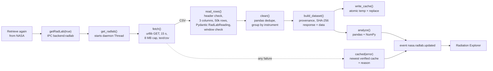
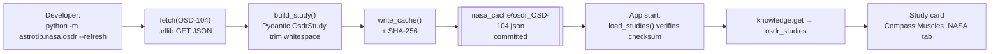
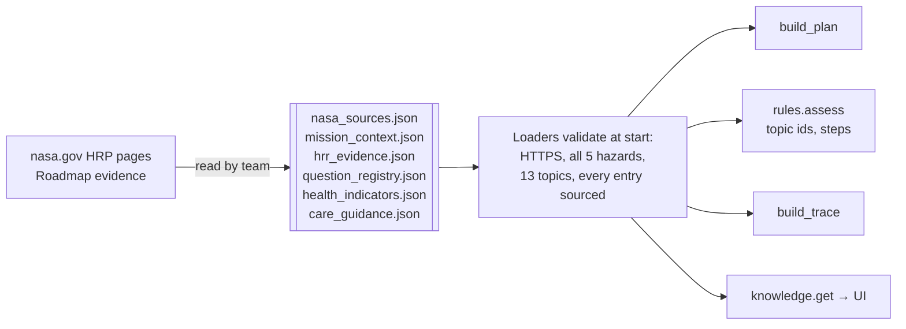
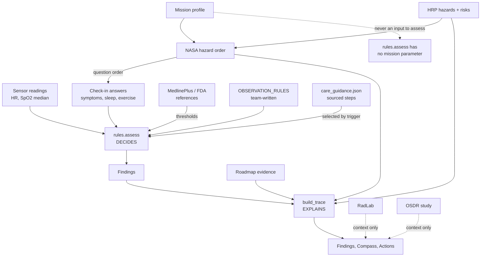
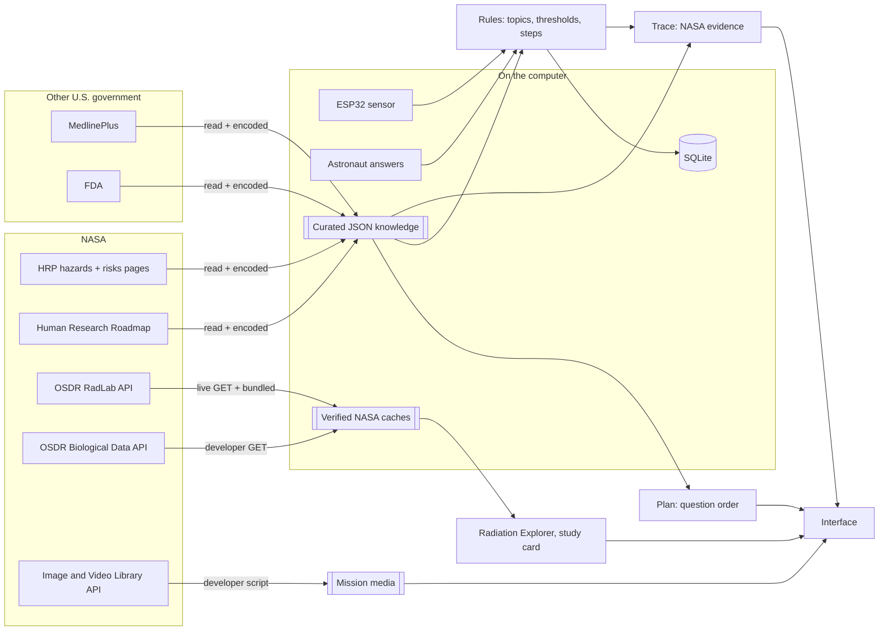

# Data sources and API architecture

Every NASA and non-NASA data source, API, dataset, research resource and
external service in AstroLife: where it comes from, how it is retrieved,
processed and stored, what it changes in the app, and how sure we are that it
works.

Audited on 2026-11-15 from the source code. Example outputs were produced by
running the real backend functions on the bundled data that day.

Contents

1. [Inventory](#1-inventory)
2. [NASA sources: actual utilization](#2-nasa-sources-actual-utilization)
3. [Non-NASA sources](#3-non-nasa-sources)
4. [Pipelines](#4-pipelines)
5. [Search and NASA knowledge retrieval](#5-search-and-nasa-knowledge-retrieval)
6. [Health analysis and scientific evidence](#6-health-analysis-and-scientific-evidence)
7. [Five verified examples](#7-five-verified-examples)
8. [API technical explanation](#8-api-technical-explanation)
9. [Does NASA data have real value in the app?](#9-does-nasa-data-have-real-value-in-the-app)
10. [Presentation: How AstroLife Utilizes NASA Data and External APIs](#10-presentation-how-astrolife-utilizes-nasa-data-and-external-apis)

### Evidence classification

| Class | Meaning |
|---|---|
| **Implemented and verified** | Code exists and automated tests or recorded hardware checks exercise it |
| **Implemented but not fully tested** | Code exists; some behaviour has no test |
| **Partially implemented** | Part of the described capability exists |
| **Research/reference only** | Read by the team and encoded or linked; no live integration |
| **Planned but not implemented** | Mentioned, or a stub file exists, but no working code |

### Five ways data enters AstroLife (never confuse them)

| Way | Meaning | Examples |
|---|---|---|
| **Live API retrieval in the app** | The running app makes an HTTP request | RadLab "Retrieve again from NASA" |
| **Developer API retrieval, then bundled** | A developer runs a command; the result is committed and shipped | OSDR OSD-104 record; NASA images and clips; also the RadLab snapshot |
| **Manually encoded scientific knowledge** | A person read a web page and wrote validated JSON with a link back | HRP hazards and risks, Roadmap evidence, MedlinePlus/FDA references and steps |
| **Bundled third-party asset** | A file downloaded once and shipped | NASA astronaut GLB, `open-anatomy-3d` models |
| **Links to external websites** | The app opens a page in the system browser | Every NASA source link (only `https://*.nasa.gov` allowed) |

---

## 1. Inventory

### 1.1 Summary table

| # | Source | Provider | Data type | API or dataset | Access method | Used by | Actual purpose | Class |
|---|---|---|---|---|---|---|---|---|
| 1 | Five Hazards of Human Spaceflight | NASA HRP | Text, curated | Web page | Manually encoded in `nasa_sources.json`, `mission_context.json` | Plan, hazards page, trace | Order check-in topics per mission; explain findings | Research/reference only → encoded use **Implemented and verified** |
| 2 | Risks of Human Spaceflight and 20 risk/hazard pages | NASA HRP | Text, curated | Web pages | Manually encoded in `nasa_sources.json` (13 topics) | Rules (topic ids), trace, Compass, NASA tab | Health topics, why it matters, monitoring, countermeasures, limits | Research/reference only → encoded use **Implemented and verified** |
| 3 | Human Research Roadmap evidence reports | NASA HRP | Links, titles, risk ids | Web pages | Manually encoded in `hrr_evidence.json` | Plan, trace, Compass, NASA tab | Evidence behind each topic and finding | Research/reference only → encoded use **Implemented and verified** |
| 4 | OSDR RadLab | NASA OSDR | Radiation dose-rate time series, CSV | **API** | Live in app + bundled verified cache | Radiation Explorer | Historical context per mission environment | **Implemented and verified** |
| 5 | OSDR Biological Data API | NASA OSDR | Study metadata, JSON | **API** | Developer refresh + bundled verified cache | Compass (Muscles), NASA tab | Pointer to real space-biology research | **Implemented and verified** (cache path); live refresh is a developer step |
| 6 | NASA Image and Video Library | NASA | Image/video metadata JSON + JPG/MP4 | **API** (`/search`, `/asset`) | Developer script, bundled files + `media_manifest.json` | Mission cards, hero | Decoration with credits | **Implemented but not fully tested** (no test calls the script; the manifest is tested in `missions.test.ts`) |
| 7 | NASA 3D Resources astronaut | NASA | GLB 3D model | Download | Bundled `desktop/public/models/nasa-astronaut.glb` | Welcome scene | Decoration | Implemented (decorative) |
| 8 | MedlinePlus (5 pages) | U.S. National Library of Medicine | Text, curated | Web pages | Manually encoded in `nasa_sources.json` sources, `rules.py` constants, `care_guidance.json` | Rules, indicators, guidance | SpO₂ and HR reference values; self-care steps; emergency signs | Research/reference only → encoded use **Implemented and verified** |
| 9 | FDA (2 pages) | U.S. Food and Drug Administration | Text, curated | Web pages | Manually encoded | Rules notes, measuring instructions | Oximeter accuracy limits; how to measure | Research/reference only → encoded use **Implemented and verified** |
| 10 | `open-anatomy-3d` (BodyParts3D, Human Reference Atlas, MakeHuman) | DBCLS, HuBMAP, MakeHuman, open-anatomy-3d | GLB anatomy models + structure catalog | npm package | Bundled | Health Compass | Clickable body | Implemented; 3D not covered by automated tests |
| 11 | ESP32 + MAX30102 | Team hardware | Serial text: PPG samples, HR/SpO₂ estimates | Device | USB serial via pyserial | Measurement, Monitor, rules | The objective measurement | Implemented; transport verified; finger-on in React not yet verified; accuracy not validated |
| 12 | Astronaut answers | User | Structured answers | — | UI → bridge, validated | Rules | Symptoms, sleep, exercise, mood | **Implemented and verified** |
| 13 | Manual vital entry | User | HR, SpO₂ typed from another instrument | — | Measurement fallback | Rules | Stored as `manual` | **Implemented and verified** |
| 14 | Simulated stream | App | Firmware-format text (72 bpm, 98 %) | — | `SimulatedReader` | Demo fallback | Labelled "simulated", excluded from trends | **Implemented and verified** |
| 15 | Local history | App | SQLite rows | — | `HistoryStore`, `AppStateStore` | History, trends, dashboard | Persistence | **Implemented and verified** |
| — | Search engine, AI provider, other third-party API | — | — | — | — | — | — | **Not present** |
| — | Camera / image input | — | — | — | Empty `inputs/camera_capture.py`, `inputs/image_input.py` | — | — | **Planned but not implemented** |
| — | Blood pressure, glucose, temperature | — | — | — | — | — | — | **Not implemented** |

### 1.2 Detail per source

| # | Official URL / endpoint | API key? | Internet? | Format | Retrieval | Cleaning / transform | Stored | Modules | Influences | Tested? |
|---|---|---|---|---|---|---|---|---|---|---|
| 1 | https://www.nasa.gov/hrp/hazards/ | No | No (encoded) | HTML → JSON | Read by the team, reviewed 2026-11-14 | Summarised in own words with source ids | `software/resources/nasa_sources.json`, `mission_context.json` | `nasa_guidance.py`, `mission_context.py`, `assessment_plan.py` | Topic order; hazard ranks in trace | `test_catalog.py`, `test_nasa_functional.py` |
| 2 | https://www.nasa.gov/hrp/risks/ and `https://www.nasa.gov/reference/risk-of-...` pages (full list in `nasa_sources.json`) | No | No | HTML → JSON | Read by the team | 13 topics with fields `why_it_matters`, `monitoring`, `countermeasures` (with evidence status), `research`, `limitations` | `nasa_sources.json` | `nasa_guidance.py`, `rules.py` (topic list), UI | Topic each finding belongs to; explanation text | `test_catalog.py` |
| 3 | https://humanresearchroadmap.nasa.gov/evidence/ | No | No | HTML → JSON | Read by the team, reviewed 2026-11-15 | Risk id, risk title, risk URL (`?i=<id>`), report title and URL; host must be the Roadmap's | `hrr_evidence.json` | `hrr_evidence.py`, `assessment_plan.py` | Trace `nasa_risks` | `test_nasa_functional.py`, `test_catalog.py` |
| 4 | `https://visualization.osdr.nasa.gov/radlab/api/?query=timestamp%3E%3D2023-01-01%20AND%20timestamp%3C2023-01-02&columns+=absorbed_dose_rate` | No | Only for refresh | CSV | `urllib.request` GET, 15 s timeout, 8 MB cap, 50,000-row cap | Pydantic per row; pandas dedupe and group; values unchanged | Bundled `software/resources/nasa_cache/radlab_absorbed_dose_rate_2023-01-01.json`; user cache `<history folder>/nasa_cache/` | `nasa/radlab.py`, `radlab_analysis.py`, `models.py`, `bridge/service.py` | Radiation Explorer content only | `test_radlab.py` (17 tests incl. failures), `test_nasa_functional.py`; live test opt-in |
| 5 | `https://visualization.osdr.nasa.gov/biodata/api/v2/dataset/OSD-104/` | No | Only for developer refresh | JSON | `python -m astrotip.nasa.osdr --refresh` | Pydantic `OsdrStudy` (`extra="forbid"`), whitespace trim only | `nasa_cache/osdr_OSD-104.json` | `nasa/osdr.py`, `osdr_studies.json` | Study card text | `test_osdr.py` (10 tests); live test opt-in |
| 6 | `https://images-api.nasa.gov/search`, `/asset/{nasa_id}` | No | Only for developer script | JSON + JPG/MP4 | `python software/scripts/fetch_nasa_media.py --with-video` | Pick a size; HTTPS only; size caps; record credit and classification | `software/assets/nasa/` + `media_manifest.json` | `desktop/src/lib/missions.ts` | Imagery only | Manifest tested in `missions.test.ts` |
| 7 | https://science.nasa.gov/3d-resources/astronaut/ | No | No | GLB | Downloaded 2026-11-15 | Unchanged | `desktop/public/models/` | `space-scene.tsx` | Nothing (decoration) | — |
| 8 | medlineplus.gov pages: pulse-oximetry, 003399 (pulse), healthysleep, 003093 (dizziness), 001927 (emergencies) | No | No | HTML → constants/JSON | Read by the team (4 pages read 2026-11-15) | Restated in plain words with source ids | `rules.py`, `care_guidance.json`, catalog `sources` | `rules.py`, `care_guidance.py` | **Thresholds**, self-care steps | `test_rules.py` |
| 9 | fda.gov pulse-oximeters and pulse-oximeter-basics | No | No | HTML → JSON | Read by the team | Restated | `care_guidance.json`, notes | `rules.py` | Accuracy notes, measuring instructions | `test_rules.py` |
| 10 | npm `open-anatomy-3d@^0.1.0` | No | No | GLB + JS catalog | `npm install`, bundled by Vite | Skin and reproductive meshes removed at load | `node_modules` → build | `anatomy-viewer.tsx`, `regions.ts` | Region picked | `regions.test.ts` |
| 11 | Local USB serial port | — | No | Text lines | pyserial on a `QThread` | Parser validation, quality, 3-report median | Median in `assessment_sessions.measurement_json`; then `checkins` | `sensor_serial.py`, `optical_quality.py`, `reading_stability.py`, `service.py` | **Rule inputs** | `test_sensor_serial.py`, `test_reading_stability.py`, `test_optical_quality.py`, `test_ppg_bridge.py`, `test_bridge.py` |

---

## 2. NASA sources: actual utilization

### 2.1 Five Hazards of Human Spaceflight

**A. What NASA provides.** HRP groups the dangers of spaceflight into five
hazards: space radiation; isolation and confinement; distance from Earth;
altered gravity fields; hostile or closed environments. Each hazard page
explains what it is and which health risks it causes.

**B. Why we need it.** The challenge asks how spaceflight hazards affect
health indicators. The hazards are NASA's own top-level organisation of the
problem, so using them makes AstroLife's structure recognisably NASA's.

**C. How we obtain it.** Read by the team; encoded in `nasa_sources.json`
(`hazards`, plus `hazard_ids` on each topic) and in `mission_context.json`
(per mission: `hazard_order` and `emphasis` with a `rationale` and NASA
`source_ids`). Validated at start: all five present, every mission lists each
hazard exactly once, every emphasis has a NASA source.

**D. How AstroLife uses it.**

| Task | How |
|---|---|
| Order the check-in for the mission | `domain_order` sorts topics by the earliest of their hazards in `hazard_order` |
| Explain why a topic is first | `build_plan` writes "Linked to the NASA hazard … presented second for a Mars / Deep Space mission" |
| Show the hazards page | All five always shown, ordered and emphasised per mission |
| Rank hazards in the trace | `build_trace` adds `rank` and `emphasized` per hazard |

Actual orders (from `mission_context.json`):

| Mission | Hazard order |
|---|---|
| Low Earth orbit | gravity, environment, isolation, radiation, distance |
| Lunar | radiation, gravity, distance, environment, isolation |
| Mars / deep space | radiation, distance, isolation, gravity, environment |

**E. Effect on output.** Changes **question order, plan text and trace
context**. Does **not** change any finding. The order is AstroLife's
editorial choice, informed by NASA statements, not a NASA ranking; the
catalog's `priority_note` says so.

**F. Implementation.** `software/astrotip/analysis/mission_context.py`
(`load_mission_context`, `validate_mission_context`, `validate_profile`),
`software/astrotip/questionnaire/registry.py` (`domain_order`),
`software/astrotip/analysis/assessment_plan.py` (`build_plan`, `build_trace`,
`_hazard_rank`), `desktop/src/questions/engine.ts` (`domainOrder`).

### 2.2 Risks of Human Spaceflight (HRP risk pages)

**A. What NASA provides.** One page per risk (hypoxia, cardiovascular
adaptations, reduced fitness, bone changes, SANS, sensorimotor/vestibular,
sleep, behavioural, teamwork, immune, host-microorganism, nutrition,
decompression, EVA, radiation cancer, systems support, dynamic loads):
description, evidence, countermeasures, research status.

**B. Why we need it.** It defines the health topics an astronaut check-in
should cover and the countermeasures NASA studies.

**C. How we obtain it.** Read by the team and summarised into 13 AstroLife
health topics in `nasa_sources.json`. Each topic has `hazard_ids`,
`why_it_matters`, `priority_rationale`, `monitoring`, `countermeasures` (each
with an `evidence` status), `research`, `limitations` and `source_ids`. 23 of
the 30 catalog sources are NASA pages.

**D. How AstroLife uses it.**

| Task | How |
|---|---|
| Define the set of findings | `rules.assess` creates one finding per catalog topic |
| Map symptoms to topics | `OBSERVATION_RULES` uses topic ids, e.g. `dizziness → vestibular` |
| Explain a finding | Topic title, why it matters and limits shown with each prompt |
| Countermeasures | Shown in Compass and NASA tab; some restated in `care_guidance.json` steps with NASA sources |
| Monitoring notes | Answer "which measurements can be performed in space" |
| Link indicators to risks | `health_indicators.json` `condition_ids` (heart rate → cardiovascular; SpO₂ → hypoxia; sleep → sleep; exercise → fitness, bone) |

**E. Effect on output.** Decides **which topic a finding belongs to** and
**what explanation and sources accompany it**. The *level* of a finding comes
from the rules.

**F. Implementation.** `analysis/nasa_guidance.py` (`load_catalog`,
`validate_catalog`, `CONDITION_IDS`), `analysis/rules.py`,
`components/flow/guidance.tsx`, `components/compass/compass-page.tsx`,
`components/pages/nasa-page.tsx`.

### 2.3 Human Research Roadmap evidence reports

**A. What NASA provides.** For each HRP risk, a Roadmap entry (numeric id)
and an evidence report summarising the research.

**B. Why we need it.** It is the strongest public NASA evidence for why a
topic matters. Linking it to each finding shows our prompts sit on NASA's
research.

**C. How we obtain it.** Read from https://humanresearchroadmap.nasa.gov/evidence/;
encoded in `hrr_evidence.json` (reviewed 2026-11-15). Validation: every
topic has at least one report; every link is on `humanresearchroadmap.nasa.gov`;
the risk link ends with `?i=<risk_id>`.

| Topic | Roadmap risk ids |
|---|---|
| hypoxia | 173 |
| cardiovascular | 179 |
| fitness | 180 |
| bone | 77 |
| sans | 105 |
| vestibular | 88 |
| sleep | 100 |
| behavioral | 99, 101 |
| immune | 85, 80 |
| nutrition | 176 |
| eva | 84, 168 |
| radiation | 96 |
| medical_support | 95, 167 |

**D. Use.** `build_trace` copies `risk_id`, `risk_title`, `risk_url`,
`report_title`, `report_url` into each finding's `nasa_risks` and the ids into
`traceability.nasa_risk_ids`. The hazards page, Compass and NASA tab list the
same reports per topic.

**E. Effect.** Explanation and auditability. No diagnosis, threshold or
treatment comes from it.

**F. Implementation.** `analysis/hrr_evidence.py` (`load_hrr_evidence`,
`validate_hrr_evidence`), `analysis/assessment_plan.py`.

### 2.4 NASA OSDR RadLab API

**A. What NASA provides.** The Open Science Data Repository's RadLab offers
radiation measurements from instruments on the ISS, in lunar orbit, Mars
orbit and on the Mars surface, queryable by time and column.

**B. Why we need it.** Radiation is the first hazard for lunar and Mars
missions, and a fingertip sensor cannot measure it. RadLab lets the app show
real data about the radiation environment of each mission type, honestly
labelled.

**C. How we obtain it.** One bounded GET request for one UTC day
(2023-01-01) and one measurement (`absorbed_dose_rate`). Python's
`urllib.request` with a 15 s timeout and an 8 MB cap. Section 8 walks
through the code.

**D. How AstroLife uses it.**

- Validates every row (Pydantic `RadLabReading`): readable timestamp inside
  the window, non-empty instrument id, finite non-negative value. One bad row
  rejects the whole response.
- Cleans with pandas: drops exact duplicate rows, groups by instrument,
  keeps published order. Nothing is filled in, rounded or dropped as an outlier.
- Analyses per instrument with pandas and NumPy: count, mean, median,
  min, max, standard deviation, 95th percentile, time of maximum, cadence,
  coverage, gaps (> 3× usual interval), excursions (> 3× own median),
  hourly means, first vs second half.
- Groups instruments by mission environment (`radlab_instruments.json`):
  LEO `DosTel1`, `Lidal`; lunar `CRaTER-D1D2`; Mars `Liulin-MO-AB-Orbit`,
  `Liulin-MO-CD-Orbit`, `MSL-RAD-Surface`; `BPD` and `REM-Lid` undescribed.
- Shows the astronaut's mission instruments first.

Real output for `MSL-RAD-Surface` (Curiosity rover) from the bundled snapshot:

```text
82 readings, typically one every 17.1 minutes.
Mean 6.48, median 6.42, range 5.81 to 7.51.
About 97.6% of the readings expected for the day at that interval are present.
No pause longer than three times the usual interval.
No reading is more than 3 times this instrument's median.
Second half of the day compared with the first: mean down 3%.
```

**E. Effect on output.** Only the Radiation Explorer. **No rule reads it.**
It is never presented as the astronaut's exposure, live telemetry or a
cumulative dose. Unit: "not stated by the API" (the response has no unit
column and RadLab's documentation returned HTTP 500 when this was built).

**F. Implementation.** `software/astrotip/nasa/radlab.py` (`request_url`,
`fetch`, `read_rows`, `clean`, `build_dataset`, `verify_dataset`,
`write_cache`, `RadLabService.cached`, `RadLabService.refresh`),
`nasa/radlab_analysis.py` (`analyze_series`, `analyze`), `nasa/models.py`
(`RadLabReading`, `RadLabDataset`), `bridge/service.py` (`get_radlab`),
`desktop/src/components/nasa/radiation-explorer.tsx`.

### 2.5 NASA OSDR Biological Data API

**A. What NASA provides.** Metadata for OSDR space-biology studies: title,
organism, tissue, study factors, mission, assays, dates.

**B. Why we need it.** To connect a health topic to real open NASA research
data, beyond the summary pages.

**C. How we obtain it.** `GET https://visualization.osdr.nasa.gov/biodata/api/v2/dataset/OSD-104/`
by a developer (`python -m astrotip.nasa.osdr --refresh`), retrieved
2026-11-15T09:24:58Z; stored with a SHA-256 checksum. The app does not call
this API at runtime.

**D. Use.** The cached record for **OSD-104**: "Rodent Research-1 (RR1) NASA
Validation Flight: Mouse soleus muscle transcriptomic and epigenomic data";
organism *Mus musculus*; material soleus; factor spaceflight; ISS, SpaceX-4,
9/21/14–10/25/14; RNA-Seq and whole-genome bisulfite sequencing; Ames;
released 2017-02-28. `osdr_studies.json` links it to `fitness` and says why.

**E. Effect.** A study card in Compass → Muscles and in the NASA tab, labelled
"Animal study · not human data · not a measurement of you". No rule uses it.

**F. Implementation.** `software/astrotip/nasa/osdr.py` (`request_url`,
`fetch`, `build_study`, `verify_record`, `load_studies`, `refresh`, `main`),
`desktop/src/components/nasa/osdr-study.tsx`.

### 2.6 NASA Image and Video Library

**A–B.** Public NASA images and videos. Used to give each mission card a real
NASA photo or clip.

**C.** Developer script `software/scripts/fetch_nasa_media.py` calls
`https://images-api.nasa.gov/search` (query, media type, page size) to find
the hand-picked `nasa_id`, then `/asset/{nasa_id}` for file URLs, downloads
with size caps, and writes `media_manifest.json` with NASA id, title,
credit, date, classification ("Photograph", "Data visualization · not
footage", "historical Apollo surface reference") and source link.

**D–E.** Imagery and credits on mission cards. No health information; no
effect on analysis.

**F.** `software/scripts/fetch_nasa_media.py`, `software/assets/nasa/`,
`desktop/src/lib/missions.ts`.

### 2.7 NASA 3D Resources astronaut model

Bundled GLB (source: DigitalSpace Corporation via NASA 3D Resources),
unchanged, cursor-reactive decoration in `space-scene.tsx`. No data role.

---

## 3. Non-NASA sources

### 3.1 MedlinePlus (U.S. National Library of Medicine)

| Question | Answer |
|---|---|
| What | The NIH's consumer health information service |
| Why selected | Public U.S. government health guidance in plain language; NASA does not publish universal vital-sign cutoffs |
| Authoritative? | Authoritative for **general adult patient guidance**. Not a spaceflight or mission limit; the app says so |
| Interface | Web pages; no API used |
| What we take | SpO₂ 92 % ("contact a clinician") and 88 % ("immediate medical attention"); resting HR 60–100 bpm and "rest 10 minutes"; sleep habits (7–9 h); dizziness home care; emergency signs |
| Processing | Restated in plain words in `rules.py` constants and `care_guidance.json`, each with a `source_id` |
| Features | Rules, indicator colour status, self-care steps, safety screen |
| Necessary? | Yes for the current thresholds and steps |
| If unavailable | Nothing changes at runtime (encoded); links would not open |

### 3.2 FDA

FDA "Pulse Oximeters" and "Pulse Oximeter Basics": accuracy limits (motion,
poor circulation, cold skin, nail polish, skin pigmentation) and how to take a
fingertip reading. Used in rules notes and measuring instructions.
Authoritative for device guidance. Encoded; no runtime dependency.

### 3.3 `open-anatomy-3d`

Third-party npm package with anatomy GLB models from BodyParts3D © DBCLS
(CC BY 4.0), Human Reference Atlas 3D Reference Organs, HuBMAP (CC BY 4.0) and
MakeHuman (CC0). A reference anatomy for navigation, not medical imaging of
the user. Attribution in README and `desktop/THIRD_PARTY_NOTICES.md`.

### 3.4 Not present

No AI provider, no search engine, no general-purpose third-party API, no
medical dataset, no analytics or telemetry service.

### 3.5 Licensing and credibility notes

- NASA content is used under NASA's media usage guidelines; no endorsement implied.
- MedlinePlus and FDA pages are U.S. government works.
- AstroLife's own code has no LICENSE file yet (`docs/CHALLENGE_REVIEW.md`).

---

## 4. Pipelines

### 4.1 RadLab (live API)



| Step | Technology | Receives | Produces |
|---|---|---|---|
| Request | Electron IPC → JSON line | `{refresh: true}` | `{refreshing: true}` immediately |
| Retrieve | `urllib.request` | Fixed URL | CSV text or `RadLabError` |
| Validate | `csv`, Pydantic `TypeAdapter(list[RadLabReading])` | CSV | Typed readings or error naming the row |
| Clean | pandas | Readings | Per-instrument series + step list |
| Store | `hashlib`, `json`, `tempfile`, `os.replace` | Dataset | User cache file |
| Analyse | pandas, NumPy | Dataset + instrument notes | Statistics, gaps, excursions, plain statements |
| Explain | `radlab_analysis` | Statistics | Text lines, limits |
| Display | React, uPlot | Event payload | Chart, statistics, provenance panel |

Offline path: `get_radlab(false)` → `RadLabService.cached()` → newest of the
user cache and the bundled snapshot that passes `verify_dataset`; if none,
`{"available": false, "error": "No verified NASA radiation dataset is available offline."}`.

### 4.2 OSDR (developer refresh, bundled)



### 4.3 Manually encoded NASA knowledge



### 4.4 Sensor

`MAX30102 → I²C → ESP32 firmware (gates + Maxim algorithm) → USB serial text →
SerialReader/ReportParser → OpticalSignalQuality → ReadingStability (3
agreeing reports, median) → session measurement_json → session.submit →
rules.assess`. Raw samples: `→ PpgBatcher → sensor.ppg.batch → ppg-buffer → uPlot`
(memory only). Details in [02-architecture-handbook.md](02-architecture-handbook.md#4-hardware-firmware-and-sensor-data).

---

## 5. Search and NASA knowledge retrieval

| # | Question | Answer |
|---|---|---|
| 1 | What is searchable? | Nothing through a search interface. NASA knowledge is looked up by identifier |
| 2 | How did it get in? | Read from NASA pages by the team and encoded in JSON; RadLab and OSDR records retrieved by API and cached |
| 3 | From APIs or a local database? | From local JSON files loaded at startup (and the RadLab API on refresh) |
| 4 | Indexed? | Python dictionaries keyed by id after loading; no search index |
| 5 | How is a user query processed? | There is no free-text query. User actions (choose mission, answer, open a region) call specific backend methods |
| 6 | How is relevance found? | By explicit links: topic `hazard_ids`, question `domain` and `evidence_ids`, indicator `condition_ids`, region `conditionIds` |
| 7 | Keyword, embeddings, vectors, RAG? | None |
| 8 | Ranking by relevance? | No. Topics are ordered by the mission's NASA hazard order; findings by level |
| 9 | Sources and citations? | Yes. Every entry has `source_ids`; every finding stores source ids, Roadmap risk ids and review dates |
| 10 | AI to interpret? | No |
| 11 | Contribution to assessment? | Retrieved knowledge decides topic order and provides explanations; rules decide levels |
| 12 | Reliable vs unsupported? | Validation refuses entries without an HTTPS source; Roadmap links must be on the Roadmap host; countermeasures must state an evidence status; historical and animal data are labelled |

Example, query to UI: the astronaut opens **Compass → Muscles and fitness**.

1. `anatomy-viewer.tsx` click → `regionForStructure` → region `muscles`
   (`conditionIds: ["fitness"]`).
2. `compass-page.tsx` reads, already loaded via `knowledge.get`:
   `catalog.conditions["fitness"]` (NASA risk text and countermeasures),
   `hrr_evidence.conditions["fitness"]` (Roadmap risk 180 and report),
   `studiesFor("fitness")` → OSD-104 card,
   the latest result's `fitness` finding and actions.
3. The panel renders them with source links.

No query string, no scoring, no network.

---

## 6. Health analysis and scientific evidence



| Use of external data | Does AstroLife do it? | Source |
|---|---|---|
| Calculating or selecting risk thresholds | **Yes, from MedlinePlus**; **not from NASA** | `rules.py` |
| Defining assessment rules | Rules written by the team; symptom-to-topic mapping uses NASA topic ids | `OBSERVATION_RULES` |
| Evidence for a detected condition | **Yes, NASA** (risk pages, Roadmap) | `build_trace` |
| Selecting recommendations | **Yes**, steps from `care_guidance.json` (NASA, MedlinePlus, FDA), chosen by rule trigger | `steps_for` |
| Explaining spaceflight health risks | **Yes, NASA** | catalog, hazards page, Compass |
| User education | **Yes** (NASA, MedlinePlus, FDA; RadLab and OSDR as context) | UI |

**Data used to make a decision:** answers, sensor median, MedlinePlus/FDA
reference values, team-written rules.
**Data used to explain or support a decision:** NASA hazards and their order,
NASA risk pages, Roadmap evidence, NASA countermeasures, RadLab, OSDR.
**Data that shapes what is asked (structure, not outcome):** NASA hazard order
and mission context.

---

## 7. Five verified examples

Outputs from the real functions on 2026-11-15.

### Example 1: Mission choice reorders the check-in

1. **Astronaut:** chooses Mars, in transit, day 120, recent EVA.
2. **Input:** `{"environment":"mars","phase":"transit","mission_day":120,"eva_recent":true}`.
3. **Source:** `mission_context.json` (NASA hazards), `question_registry.json`, `nasa_sources.json`.
4. **API request:** none.
5. **Retrieved:** Mars hazard order radiation, distance, isolation, gravity, environment.
6. **Processing:** `build_plan` → `domain_order`; EVA promoted by `promote_if`.
7. **Libraries:** Python only; `questions/engine.ts` repeats the order in the UI.
8. **Influence:** order of questions: safety, eva, wellbeing, illness, sleep, balance, heart, strength. On LEO without EVA: safety, balance, heart, strength, sleep, illness, wellbeing.
9. **Sees:** the Hazards page plan and the question order.
10. **Why useful:** the challenge asks how hazards affect indicators; this shows it in behaviour.

### Example 2: A finding traced to NASA evidence

1. **Astronaut:** reports sleeping poorly, 5 hours, several nights.
2. **Input:** `sleep.quality=poorly`, `sleep.hours=5`, `sleep.duration=several_nights`.
3. **Source:** `hrr_evidence.json`, `nasa_sources.json`, `care_guidance.json` (MedlinePlus sleep), `mission_context.json`.
4. **API:** none.
5. **Retrieved:** Roadmap risk 100; hazards isolation (rank 3) and environment (rank 5) for Mars.
6. **Processing:** `assess` raises `sleep` to watch (rules `observation:poor_sleep`, `field:sleep_hours`); `build_trace` attaches NASA context.
7. **Libraries:** Python; Pydantic `MeasurementProvenance` for measurement observations.
8. **Influence:** NASA data explains; the rule decides.
9. **Sees:** "Follow up" with steps like "Protect your scheduled sleep period…" and "Avoid caffeine in the afternoon and evening", the crew step, and the six-step trace.
10. **Why useful:** guidance plus NASA evidence, auditable.

### Example 3: Sensor reading against a cited reference

1. **Astronaut:** measures; three reports agree on HR 108, SpO₂ 91.
2. **Input:** sensor median in `measurement_json`.
3. **Source:** MedlinePlus pulse oximetry and pulse; FDA; Roadmap risks 173 and 179.
4. **API:** none.
5. **Retrieved:** references 92 % / 88 %, 60–100 bpm.
6. **Processing:** `ReadingStability` median; `assess`; `indicator_status`.
7. **Libraries:** Python `statistics`.
8. **Influence:** MedlinePlus thresholds decide `review` (SpO₂) and `watch` (HR); NASA explains.
9. **Sees:** amber chips with reference text; "Medical review"; "Rest for at least 10 minutes, then measure again…".
10. **Why useful:** objective input with honest limits.

### Example 4: Live NASA radiation data with provenance

1. **Astronaut:** opens NASA data and presses "Retrieve again from NASA".
2. **Input:** `{refresh: true}`.
3. **Source:** NASA OSDR RadLab API.
4. **API:** yes, one GET (CSV).
5. **Retrieved:** 5,359 rows across 8 instruments (bundled snapshot count).
6. **Processing:** Pydantic, pandas, NumPy; SHA-256; atomic cache.
7. **Libraries:** `urllib`, Pydantic, pandas, NumPy, `hashlib`.
8. **Influence:** Radiation Explorer only.
9. **Sees:** Mars instruments first; `MSL-RAD-Surface` 82 readings, median 6.42, coverage 97.6 %; provenance; "not your exposure".
10. **Why useful:** radiation is the top hazard for Mars and cannot be measured by the sensor.

### Example 5: A NASA space-biology study for a body region

1. **Astronaut:** Compass → Muscles → Show NASA research.
2. **Input:** region `muscles` → topic `fitness`.
3. **Source:** OSDR Biological Data API record OSD-104 (cached).
4. **API:** not at runtime (developer refresh).
5. **Retrieved:** title, organism, tissue, mission, assays, dates.
6. **Processing:** checksum verified at load; no analysis.
7. **Libraries:** Pydantic.
8. **Influence:** context only.
9. **Sees:** "Animal study · not human data · not a measurement of you" card.
10. **Why useful:** connects the topic to open NASA research data.

**Missing capabilities.** No example exists where NASA data changes a medical
threshold, where the app searches NASA literature, or where an OSDR study is
chosen automatically.

---

## 8. API technical explanation

### 8.1 What an API is

An API (application programming interface) is a defined way for one program
to ask another for data. A **web API** does this over HTTP: the client sends a
request to a URL (an *endpoint*), optionally with *parameters*, and the
server returns a response with a *status code* (200 = OK) and a *body*, often
JSON or CSV.

### 8.2 RadLab request

| Item | Value |
|---|---|
| Method | GET |
| Endpoint | `https://visualization.osdr.nasa.gov/radlab/api/` |
| Parameter `query` | `timestamp>=2023-01-01 AND timestamp<2023-01-02` (percent-encoded) |
| Parameter `columns+=` | `absorbed_dose_rate` (written literally; encoding the `+` made the server answer HTTP 500) |
| Headers | `User-Agent: AstroLife-educational-prototype/0.2 (NASA Space Apps 2026)`, `Accept: text/csv` |
| Auth | None; no API key |
| Response | CSV: `timestamp,instrument_id,absorbed_dose_rate` |
| Rate limits | None documented in the code; the app sends at most one refresh at a time |
| Caching | User cache + bundled snapshot, both checksum-verified |

### 8.3 Code excerpt (`software/astrotip/nasa/radlab.py`)

```python
def request_url() -> str:
    start, end = window()
    query = f"timestamp>={start} AND timestamp<{end}"
    return f"{API_URL}?query={urllib.parse.quote(query, safe='')}&columns+={MEASUREMENT}"


def fetch(opener=urllib.request.urlopen) -> str:
    request = urllib.request.Request(request_url(), headers={"User-Agent": USER_AGENT, "Accept": "text/csv"})
    try:
        with opener(request, timeout=TIMEOUT_SECONDS) as response:
            status = getattr(response, "status", 200)
            body = response.read(MAX_BYTES + 1)
    except (urllib.error.URLError, TimeoutError, OSError) as exc:
        raise RadLabError(f"NASA RadLab could not be reached: {getattr(exc, 'reason', exc)}") from exc
    if status != 200:
        raise RadLabError(f"NASA RadLab answered with HTTP {status}.")
    if len(body) > MAX_BYTES:
        raise RadLabError("NASA RadLab returned more data than the bounded request allows.")
    return body.decode("utf-8")
```

Line by line, conceptually:

1. `window()` returns the fixed day `2023-01-01` to `2023-01-02`, so every user gets the same, small dataset.
2. The query is a RadLab filter expression on the timestamp only (hyphenated instrument ids cannot be used in the expression, so instruments are separated locally).
3. `quote(..., safe='')` percent-encodes the query value; `columns+=` stays literal.
4. `fetch` takes an `opener` argument so tests can pass a fake one and never touch the network.
5. A `Request` object sets headers: a generic User-Agent (no personal data) and the expected format.
6. `timeout=15` stops a hung connection.
7. `read(MAX_BYTES + 1)` reads one byte more than allowed, so an oversized body can be detected without reading it all.
8. Network errors, timeouts and OS errors become one readable `RadLabError`.
9. A non-200 status is an error, not data.
10. An oversized body is refused.
11. The body is decoded as UTF-8; anything else is an error (in the full code).

What happens next: `build_dataset(text)` → `read_rows` (validate) → `clean`
(pandas) → provenance and checksums → `write_cache` → `_package` adds
`summarize` and `analyze`. On any `RadLabError`, `refresh()` returns
`cached(error=...)`, so the UI shows the verified cache and the reason.

### 8.4 OSDR request

`GET https://visualization.osdr.nasa.gov/biodata/api/v2/dataset/OSD-104/`,
`Accept: application/json`, same timeout and error handling, 2 MB cap, the
accession must match `^OSD-\d{1,5}$`. The JSON is reduced to the `OsdrStudy`
fields (unknown fields forbidden). Developer-only at present.

### 8.5 NASA Image and Video Library (developer script)

`GET https://images-api.nasa.gov/search?q=<query>&media_type=image|video&page_size=20`
→ JSON `collection.items[].data[0]` with `nasa_id`, `title`, `center`,
`date_created`; then `GET /asset/{nasa_id}` → file URLs. HTTPS enforced,
size caps on downloads.

### 8.6 Tests that prove the API handling

`test_radlab.py`: request bounded to one day of one measurement; HTTP and
network failures reported without inventing data; any untrustworthy row
rejects the response; cleaning changes no value; provenance recorded and no
unit claimed; changed or damaged cache refused; offline shows bundled
snapshot with origin; failed refresh keeps the cache and says why; no cache +
no network → unavailable; refresh runs off the main thread. Live test
`test_live_retrieval_from_nasa` is skipped unless `ASTROLIFE_LIVE_TESTS=1`.
`test_osdr.py` mirrors these for OSDR, including
`test_live_record_matches_the_bundled_one` (opt-in).

---

## 9. Does NASA data have real value in the app?

| Question | Answer |
|---|---|
| Does NASA data perform a functional role? | **Yes.** The NASA hazard order changes the check-in's question order and plan; tests prove it (`test_changing_the_mission_changes_topic_order_and_reasons`) |
| Does it support analysis or decision-making? | It shapes the structure (what is asked first, which topic a finding belongs to). It does **not** set levels or thresholds (`test_changing_the_mission_changes_the_hazard_context_but_not_the_finding`) |
| Evidence for recommendations? | **Yes.** Every finding carries NASA risk and Roadmap evidence; many self-care steps cite NASA risk pages |
| Used in search and retrieval? | Retrieval by id, yes; search, no |
| Only displayed? | RadLab and OSDR are displayed as context, after real retrieval, validation and analysis |
| Traceable from source to output? | **Yes.** Source ids → catalog URL; Roadmap risk ids → Roadmap page; RadLab request URL and checksums in the provenance panel |
| Working integrations | Encoded HRP/Roadmap knowledge; RadLab live + cache; OSDR cache; media manifest |
| Incomplete or experimental | OSDR live refresh is developer-only and one study; RadLab unit unverified; two instruments undescribed; only one RadLab day |

**Assessment.** AstroLife meets the "use NASA data" expectation with a real
NASA API pipeline (RadLab), a second NASA API record (OSDR), and NASA
research that measurably changes the software's behaviour (question order and
plan) and explains every result. The honest limit is that NASA data is not
an input to the health rules. That is a deliberate safety choice, and it
should be presented as such, not hidden.

---

## 10. Presentation: How AstroLife Utilizes NASA Data and External APIs

### 30-second explanation (general audience)

"We used NASA's Human Research Program, which lists the five big hazards of
spaceflight and the health risks they cause. AstroLife uses that to decide
what to ask an astronaut first: on a Mars mission, radiation and distance come
first; on the space station, gravity does. Every piece of advice links to
NASA's evidence. We also pull real radiation measurements from NASA's open
science data API and show them, clearly labelled, as background, not as the
astronaut's own exposure."

### 2-minute technical explanation

"There are three kinds of NASA input. First, curated research. We read NASA's
HRP hazard and risk pages and the Human Research Roadmap, and encoded them as
JSON: five hazards, 13 health topics, 23 NASA sources, and the Roadmap risk
ids and evidence reports for each topic. Each mission has a hazard order with
a NASA-sourced rationale. The backend validates all of it at startup:
HTTPS links, every claim sourced, all five hazards present, Roadmap links on
NASA's host.

Second, those files drive behaviour. `build_plan` sorts the check-in topics
by the mission's hazard order and writes the reason for each, and a recent EVA
promotes the EVA topic. After the rules produce findings, `build_trace`
attaches the NASA hazard and its rank for this mission, the Roadmap risk and
its evidence report, the astronaut's own observation and the rule id. Tests
show that changing the mission changes the question order and the context,
but not the finding, because the thresholds come from MedlinePlus general
references, not from NASA, which doesn't publish universal vital-sign cutoffs.

Third, NASA APIs. The OSDR RadLab API is called with one bounded GET request
for one day of absorbed dose rate. Every CSV row is validated with Pydantic,
pandas removes exact duplicates and groups by instrument, and pandas and NumPy
compute statistics, gaps and excursions. The dataset is stored with SHA-256
checksums and shown with its provenance. The app can retrieve it live on a
worker thread, and falls back to the verified cache offline. We also cached one
study from the OSDR Biological Data API, a mouse muscle study, shown with the
muscle topic and labelled as animal data."

### Data architecture diagram



### Verified sources table

| Source | Kind | Live in app? | Changes behaviour? | Class |
|---|---|---|---|---|
| HRP five hazards | Encoded research | No | Question order, plan | Implemented and verified (encoded) |
| HRP risk pages | Encoded research | No | Topic of each finding, explanations | Implemented and verified (encoded) |
| Human Research Roadmap | Encoded research | No | Evidence in every trace | Implemented and verified (encoded) |
| OSDR RadLab | API | **Yes** (refresh) | Radiation Explorer content | Implemented and verified |
| OSDR Biological Data | API | No (developer) | Study card | Implemented and verified (cache) |
| NASA Image and Video Library | API | No (developer) | Imagery | Implemented but not fully tested |
| NASA 3D astronaut | Asset | No | Decoration | Implemented |
| MedlinePlus | Encoded reference | No | **Thresholds**, steps | Implemented and verified (encoded) |
| FDA | Encoded reference | No | Notes, instructions | Implemented and verified (encoded) |
| ESP32 + MAX30102 | Sensor | Yes | **Rule input** | Implemented; accuracy not validated |

### Demonstration scenario

Mars, recent EVA → Hazards page: show radiation first and the EVA topic
promoted, open the Roadmap link → finish a check-in with poor sleep → open the
sleep prompt's trace (hazard isolation rank 3, Roadmap risk 100) → NASA data
tab → `MSL-RAD-Surface` → provenance panel → "Retrieve again from NASA" (if
online). Say: "NASA decides what I'm asked first and explains every prompt;
the radiation data is real NASA API data, labelled as historical."

### Concepts to understand

HTTP GET, query parameters, status codes; CSV vs JSON; schema validation
(Pydantic); data cleaning without altering values; descriptive statistics
(median, percentile, standard deviation); SHA-256 checksums and why they
detect tampering; caching and offline fallback; provenance; atomic writes;
worker threads; the difference between decision data and explanatory data.

### Five likely judge questions

**1. What NASA data did you use?**
NASA Human Research Program hazard and risk pages, Human Research Roadmap
evidence reports, the OSDR RadLab radiation API and one OSDR Biological Data
API study (OSD-104). Mission imagery from the NASA Image and Video Library and
a NASA 3D astronaut model are decoration.

**2. How did you retrieve it?**
The HRP and Roadmap content was read and encoded by us into validated JSON,
with a link for every statement. RadLab is a live HTTP GET with Python's
standard client, a 15-second timeout and size limits, also bundled as a
checksum-verified snapshot. The OSDR record was retrieved by a developer
command and cached with a checksum.

**3. Why did you choose it?**
The hazards and risks are NASA's own framework for astronaut health, so they
decide what a check-in should cover. RadLab covers the hazard our sensor
can't measure, radiation, with instruments in each mission environment.

**4. How did you process it?**
RadLab: Pydantic validation of every row, pandas deduplication and grouping,
pandas and NumPy statistics, gaps and excursions, SHA-256 provenance. Curated
knowledge: validated at startup, used by `build_plan` and `build_trace`.

**5. How does it actually help AstroLife?**
It changes the software's behaviour: the mission's NASA hazard order decides
the question order, and every finding is traced to NASA's risk and evidence.
It does not set medical thresholds; those are general MedlinePlus references,
and we say that on screen. The radiation data gives mission context the
astronaut can't measure themselves.
